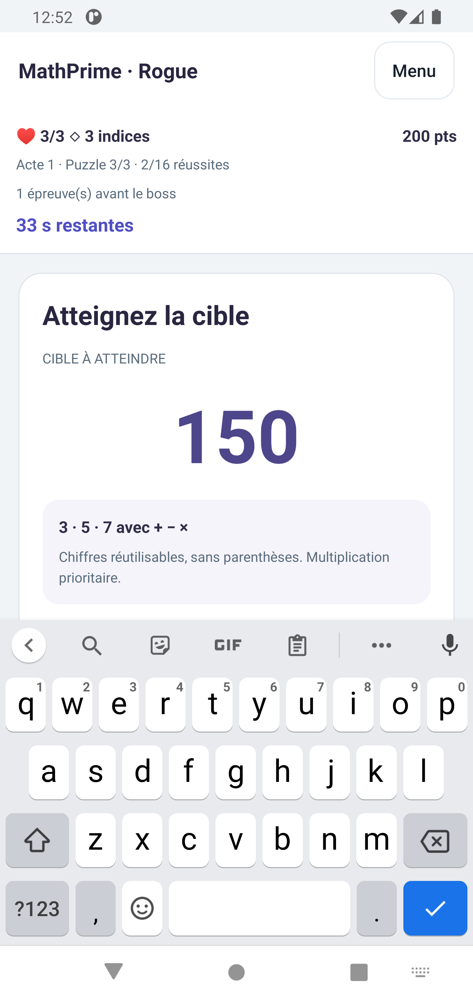
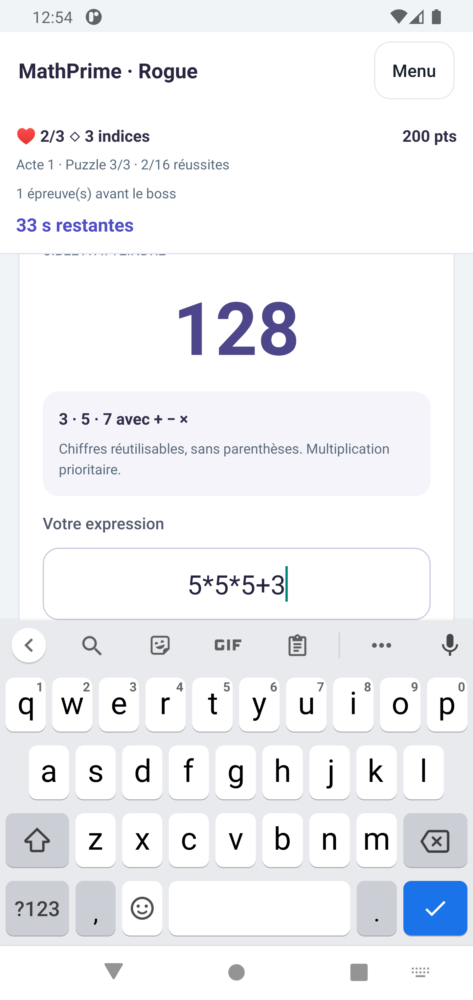
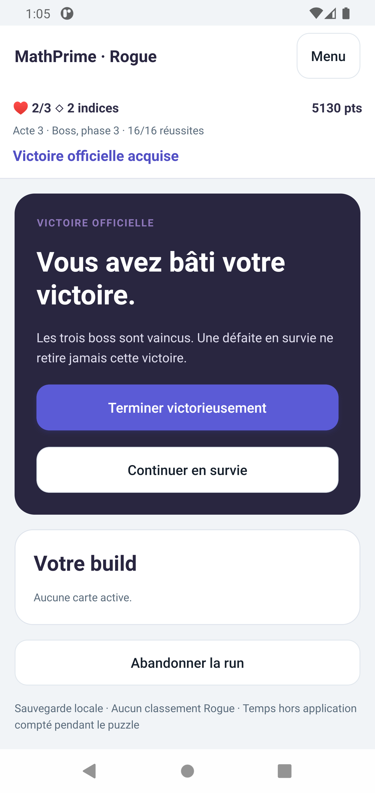
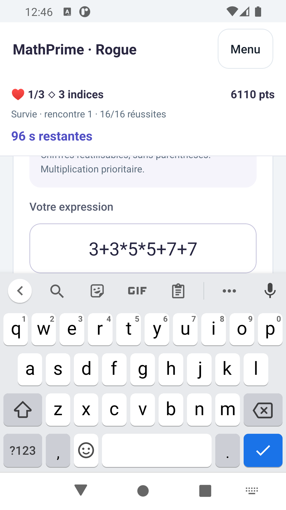
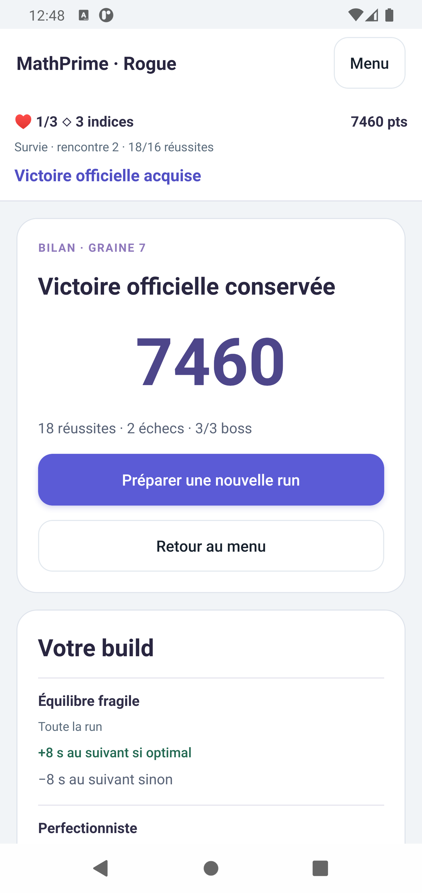
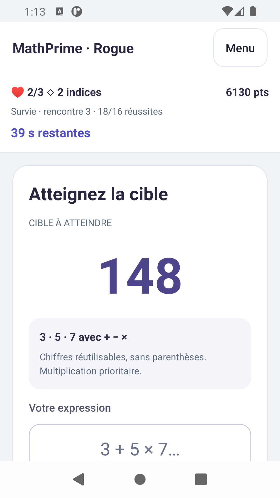
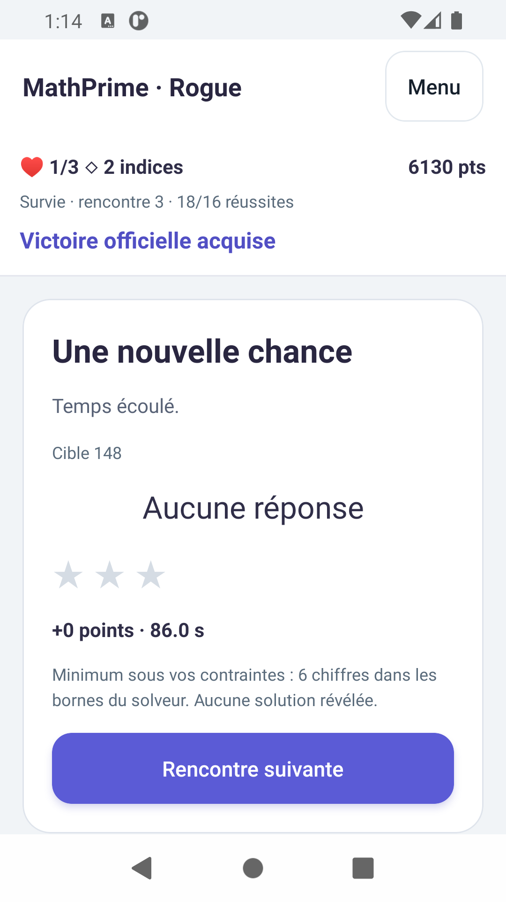
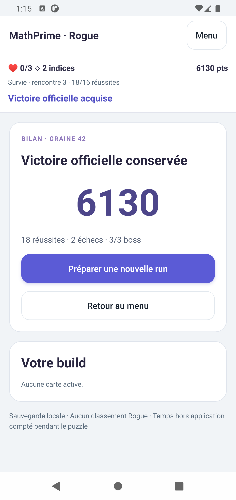

# R3.2.1 — Validation Android native avant fusion

Validation du 14 novembre 2026, sur `feat/rogue-v1-mobile-persistence`, à partir de `1667eb1`, pour la PR #11 vers `modernization`. L'arbre initial était propre. Aucune fusion effectuée.

## Environnement réellement utilisé

- Omarchy Linux ; SDK local `/home/lordaction/Android/Sdk`.
- `ANDROID_HOME` présent ; `ANDROID_SDK_ROOT` et chemins ADB/émulateur explicités pour les commandes. Java 17 sélectionné par le `mise.toml` mobile, plutôt que Java 27 du shell. Aucun réglage Linux permanent modifié.
- KVM confirmé utilisable sur l'hôte avec `emulator -accel-check`. Son absence apparente dans l'environnement restreint n'était pas une absence réelle de virtualisation.
- AVD **Pixel_4_XL**, déjà démarré lors du contrôle : `emulator-5554`, démarrage terminé, **Android 11 / API 30 / x86_64**. Il n'a pas été nécessaire de lancer une deuxième instance.
- Taille habituelle : **1440 × 3040 px, densité 560**, soit environ 411 × 869 dp. Essai supplémentaire : **1080 × 1920 px, densité 480**, soit **360 × 640 dp**. Les deux surcharges ont ensuite été remises à zéro.
- Application `com.shortest.app`, version 0.1.0, versionCode 1. Installation avec remplacement de l'APK, sans désinstallation ni effacement des données.

Le contrôle direct des fenêtres Linux/Android n'était pas accessible. Après autorisation explicite, les interactions ont été réalisées par **ADB : touches, appuis, appuis longs, glissements, saisie et captures natives**. Un pilote UIAutomator temporaire, construit avec les SDK déjà installés, a permis de lire les contrôles sans attendre l'immobilité du chronomètre.

Il s'agit bien d'interactions avec l'application React Native installée, pas d'un export Hermes présenté comme un test d'appareil. Le long parcours a été assisté par un script pilotant les contrôles Android ; ses réponses ont été calculées à partir des seules cibles et contraintes affichées. Il ne simulait pas les transitions du jeu et ne lisait pas les témoins cachés de la session. Les captures ont été inspectées. Cela ne remplace pas un playtest humain ni une mesure humaine de difficulté.

Après une longue interruption de la session, ADB détectait encore l'AVD mais `screencap` restait bloqué et la commande `am` signalait `Can't find service: activity`. Les services Android n'étaient plus opérationnels ; cela ne permettait pas de poursuivre une validation d'application. L'AVD a été fermé par `adb emu kill`, puis redémarré sans effacement ni chargement de snapshot avec `emulator -avd Pixel_4_XL -gpu swiftshader -no-snapshot-load -no-snapshot-save -no-boot-anim`. Le démarrage à froid a terminé en **23,225 s**, les données ont été retrouvées et les tests ont repris sur ce système fonctionnel. La cause initiale de l'arrêt des services n'a pas été déterminée.

## Défauts constatés et corrections limitées

Seuls les fichiers applicatifs `apps/mobile/src/screens/Rogue.tsx` et `apps/mobile/src/rogue/RogueInput.tsx` ont été corrigés.

1. **Champ masqué par le clavier.** Malgré `adjustResize` dans le manifeste existant, l'ouverture de Gboard recouvrait le champ de réponse. `KeyboardAvoidingView` utilise désormais le comportement `height` sur Android. La vue défilante réduit son espace disponible et garde le champ au-dessus du clavier ; les touches, Valider et Indice restent accessibles par défilement, sans fermeture du clavier.
2. **Position de défilement conservée entre écrans.** Après une saisie ou un défilement, le résultat et la rencontre suivante pouvaient commencer au milieu de leur carte, avec le titre hors écran. La vue revient maintenant en haut au changement d'écran/étape, y compris lors de Continuer vers un puzzle en cours, après la mise en page suivante. Le chronomètre et les indices ne déclenchent pas ce retour en haut pendant la saisie d'un même puzzle.
3. **Crash Fabric dans l'APK autonome.** Une validation après sortie/reprise Menu a provoqué `IllegalStateException: Unable to find parentView for tag 1930`, dans `SurfaceMountingManager.removeViewAt`. Le [diagnostic natif](assets/R3.2.1/fabric-crash-before.txt) et l'historique Android confirment un crash applicatif, pas une simple erreur du pilote. Le parent du pavé changeant de `pointerEvents` est maintenant explicitement non aplati (`collapsable={false}`), et la courte liste Rogue conserve ses enfants natifs (`removeClippedSubviews={false}`). L'hypothèse est une interaction entre aplatissement/détachement et suppression des vues pendant la validation ; la cause interne précise dans Fabric n'est pas démontrée. La documentation officielle [ScrollView](https://reactnative.dev/docs/ScrollView#removeclippedsubviews) avertit des risques de cette optimisation, active par défaut sur Android. Aucun changement de version React Native n'a été introduit.

Le moteur, le contrôleur partagé, les cartes, les limites de recherche, l'équilibrage, le format de sauvegarde et les adaptateurs sont inchangés. Aucune dépendance ajoutée, aucun changement Web, Daily ou Supabase.

| Avant : champ couvert | Après : champ visible |
| --- | --- |
|  |  |

## Parcours natifs effectués

| Cas | Résultat observé |
| --- | --- |
| Accueil, Continuer, préparation | Session initiale seed 42 reprise au deuxième puzzle avec 100 points et ses ressources |
| Nouvelle run et remplacement | Annulation conservant l'existant ; confirmation repartant avec cible et ressources initiales |
| Saisie mathématique | Chiffres/opérations, aperçu calculé, validation par Entrée et par commandes tactiles, effacement et déplacement du curseur |
| Sélection native | Appui long, sélection de toute l'expression puis touche `3` : remplacement par `3`, pas ajout en fin ; clavier maintenu |
| Indice | Compteur passant de trois à deux ; clavier toujours ouvert et temps toujours actif |
| Petit écran 360 × 640 dp | Champ visible avec Gboard, saisie et résultat lisibles, boutons accessibles en faisant défiler, absence de chevauchement du contenu fixe avec les zones système dans cette configuration |
| Retour Android | Ferme d'abord le clavier ; un second Retour ouvre la confirmation de sortie ; Annuler conserve le puzzle |
| Menu, abandon | Sortie avec conservation ; abandon annulable puis bilan enregistré après confirmation |
| Choix tactiles | Premier choix après deux réussites ; cartes verticales, avantages/contreparties/durées visibles, effets et expirations retrouvés dans la build |
| Trois boss | Toutes les phases jouées avec les contraintes affichées, minimum d'étoiles satisfait et récompenses visibles |
| Victoire et survie | Seize réussites, trois boss vaincus, entrée en survie puis deux réussites supplémentaires |
| Défaite et bilan | Réponse volontairement incorrecte, perte de vie, fin de parcours ; la défaite en survie conserve la victoire officielle |
| Autres modes/profil | Accueil affichant toujours 75 points et rang 2 ; ouverture de Classic puis retour, sans soumettre de réponse ni changer ce profil |

La run complète neuve utilise la **seed 42**. Cartes choisies : E3, T4, E1, E3, T5. Le sacrifice immédiat de E1 explique le passage de trois à deux vies, sans échec de puzzle pendant les seize premières réussites.

| Point du parcours | Score |
| --- | ---: |
| Premier boss vaincu, 5/16 | 850 |
| Deuxième boss vaincu, 10/16 | 2 530 |
| Troisième boss vaincu, 16/16 | **5 130** |
| Deux réussites en survie, 18 réussites | **6 130** |

Après un timeout puis une réponse incorrecte volontaire en survie, le bilan indique **18 réussites, 2 échecs, 3/3 boss, 6 130 points et victoire officielle conservée**. Ce bilan a été rouvert depuis l'accueil. Un scénario distinct de seed 7 a ensuite servi au test de sortie vers le menu en plein puzzle.

### Contre-vérification de l'APK final après correction du crash

La seed 7 a été reprise à **2/16 réussites**. Les deux expirations déjà enregistrées pendant les explorations précédentes expliquent la vie restante au début de cette campagne. Les **14 épreuves officielles restantes** ont ensuite toutes été réussies, avec sortie Menu confirmée et Continuer **avant chacune des 14 réponses**. Les boutons tactiles **Effacer, Vider et Valider** ont été utilisés avec succès sur les deux premières étapes de cette répétition. Les trois boss ont été vaincus, pour **6 110 points** à la victoire officielle.

Deux nouveaux puzzles de survie ont porté le score à **6 785 puis 7 460 points**. Le premier a été saisi avec Gboard sur **360 × 640 dp**. Sur l'ensemble de ces **16 validations après correction**, le PID est resté **4564** et le buffer de crash filtré sur ce PID était vide. Il n'y a eu ni nouveau crash ni nouvelle perte de vie dans cette campagne. La [trace des résultats](assets/R3.2.1/native-postfix-validation.txt) est conservée ; cette répétition ciblée ne prouve pas l'absence de tout défaut Fabric sur toutes les versions Android.

Après fin volontaire de la survie, fermeture du processus et relance, le bilan de seed 7 indique toujours **18 réussites, 2 échecs, 3/3 boss et 7 460 points**, avec la victoire officielle conservée. Les deux échecs sont ceux antérieurs à la campagne finale. Le profil général affiche toujours 75 points et rang 2.

## Sauvegarde et interruptions réellement vérifiées

| Interruption | Vérification native |
| --- | --- |
| Destruction avant récompense | `am force-stop`, relance, Continuer : mêmes offres, 200 points et deux vies |
| Après choix de soin E2 | Soin appliqué, puis destruction pendant le puzzle suivant ; à la reprise, expiration unique et effet à deux tentatives, sans réapplication du soin |
| Résultat et menu | Sortie, retour et reprise du même résultat : score, vies et durée de carte conservés |
| Arrière-plan pendant saisie | Home Android, attente, retour : expression non soumise conservée tant que l'écran reste monté ; résultat ensuite validé |
| APK autonome, arrière-plan | **86 s → 76 s** ; même cible 148, 6 130 points et deux vies. Les horodatages civils Android avancent de neuf secondes entre les relevés, avec les arrondis d'affichage |
| APK autonome, destruction du processus | PID **21209 → 21959** ; attente de cinq secondes puis relance/Continuer : **48 s → 39 s**, même cible 148, score et ressources. Aucun retour au budget initial de 86 s |
| APK autonome, expiration | Une vie perdue, puis nouveau `force-stop`/relance : toujours **une vie**, toujours 6 130 points, même résultat ; aucune deuxième perte |
| Bilan final | Victoire et bilan de survie conservés après navigation et changement de taille de l'AVD |
| Menu pendant puzzle, seed 7 | **35 s → 27 s** après sortie confirmée, attente de cinq secondes et reprise ; même cible 39, trois vies et trois indices ; réponse ensuite acceptée |
| Reprise après le crash constaté | Seed 7, cible 39 réussie, 100 points, trois vies et trois indices retrouvés après relance ; l'ancienne seed 42 ne remplace pas la nouvelle session |

L'APK `release` a été installé par-dessus l'APK `debug`, en conservant sa sauvegarde de 6 130 points. Le lien ADB vers Metro a été retiré, puis Metro arrêté. Le refus de connexion sur le port 8081 a été confirmé pendant le test de destruction du processus : ces reprises ne dépendent donc pas du serveur de développement.

## Contrôles exécutés

| Contrôle | Résultat |
| --- | --- |
| `npm test` après les corrections finales | **116 réussites, zéro échec** : moteur 101, Web 11, mobile 4 |
| Typechecks moteur, Web, mobile | Réussis, y compris contrats et tests déjà inclus dans leurs scripts |
| `npm run build -w @shortest/web` | Réussi |
| Script existant `npm run android -w @shortest/mobile -- --device emulator-5554 --no-bundler` avec Java 17/SDK explicite | APK debug compilé, installé et lancé ; Gradle réussi en 31 s, 324 tâches |
| `:app:assembleRelease -PreactNativeArchitectures=x86_64 --max-workers=2 --no-daemon --console=plain` | Gradle **BUILD SUCCESSFUL**, 529 tâches ; compilation finale réussie en **56 s**, code de sortie **0** ; APK autonome installé et exécuté |
| `git diff --check` | Réussi |

SHA-256 de l'APK autonome final (44 220 281 octets) : `c7a630da9d2824c3057c7f87a260981c74c610e8593c37dda0019b433ff2b8e4`. Il se trouve dans `apps/mobile/android/app/build/outputs/apk/release/app-release.apk` et n'est pas ajouté à Git. Il utilise la signature et les réglages existants du dépôt ; ce n'est pas une publication Play Store.

Transparence sur les essais non réussis : une première invocation Expo associait à tort `--port` et `--no-bundler` ; elle a été corrigée. Le lancement Metro avec arguments via le wrapper racine n'était pas correctement transmis ; le script du workspace a été utilisé. La première compilation autonome a été interrompue avec un code 143 sans diagnostic d'échec Gradle, puis relancée sans suppression de contrôles. La session de commande de cette relance a également remonté 143, malgré la fin Gradle réussie ; l'APK créé, son installation et son exécution autonome ont été vérifiés séparément.

L'instrumentation UIAutomator a parfois attendu ou perdu une hiérarchie pendant une animation. Ces essais ont été repris et ne sont pas comptés comme parcours réussis. Certaines explorations longues ont ainsi laissé expirer le chronomètre ; elles ont permis de vérifier les pertes de vie et leur absence de duplication. Un dernier arrêt de scénario était en réalité le crash Fabric décrit plus haut : il a été diagnostiqué avec le buffer de crash Android, puis corrigé. Aucune limite de recherche ni durée du jeu n'a été augmentée pour faire passer les tests.

## Limites restantes et état laissé

- Validation sur **un AVD Android 11 x86_64**, pas sur un appareil physique, ARM64, Android récent, navigation gestuelle ou autre clavier. Les deux tailles testées ne couvrent pas tous les écrans ni les grandes polices d'accessibilité.
- Les cartes réellement choisies couvrent plusieurs effets immédiats et temporaires, mais pas les douze cartes et toutes leurs améliorations/remplacements en parcours natif. La couverture moteur préexistante reste verte.
- Aucun parcours manuel complet Daily, authentification ou Supabase n'est revendiqué. Leur code n'a pas changé.
- Les garanties locales et limites de chronomètre du [rapport R3.2](R3.2-rogue-mobile-persistence.md) restent inchangées : une seule sauvegarde, texte non soumis perdu après destruction du processus, absence de cloud et d'horloge de confiance, journal borné.
- Aucune copie complète de la base de profil n'a été réalisée. Le contrôle automatique d'approbation l'a refusée comme trop large ; les vérifications ont utilisé l'interface et les tests ciblés existants.
- Taille et densité de l'AVD restaurées ; réglage initial du clavier virtuel conservé. Les fichiers temporaires du pilote ADB ont été retirés. L'APK autonome reste installé et l'émulateur reste ouvert sur le **bilan victorieux de seed 7 à 7 460 points** ; aucun chronomètre ne tourne à la fin de la validation.

Les corrections se limitent à la disposition et à la stabilité des vues natives Rogue. Le moteur et le protocole de sauvegarde sont inchangés.
