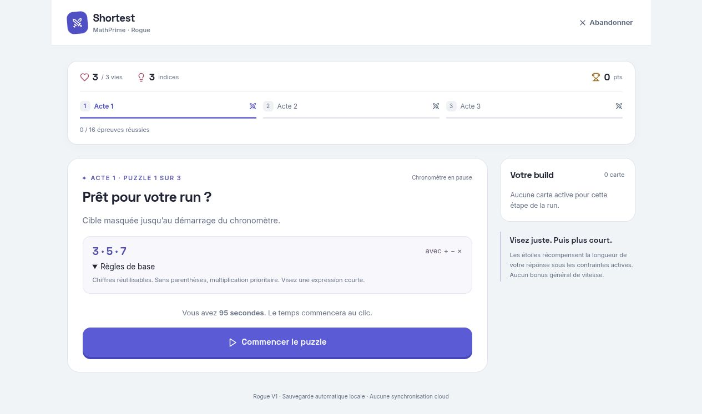
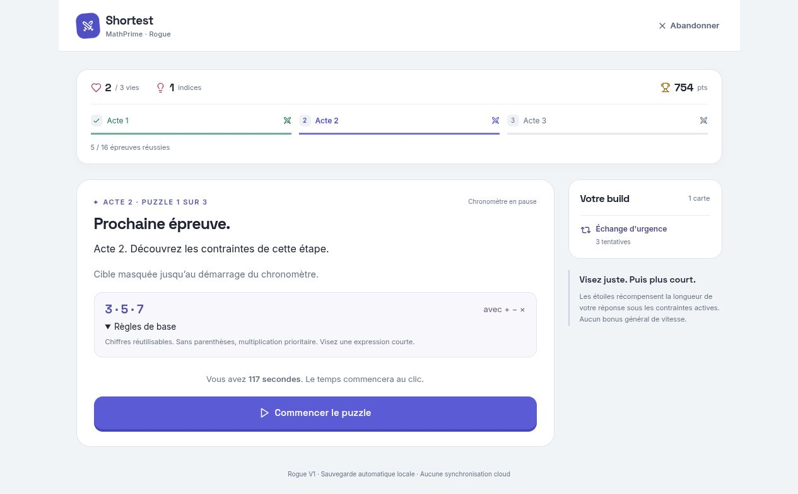
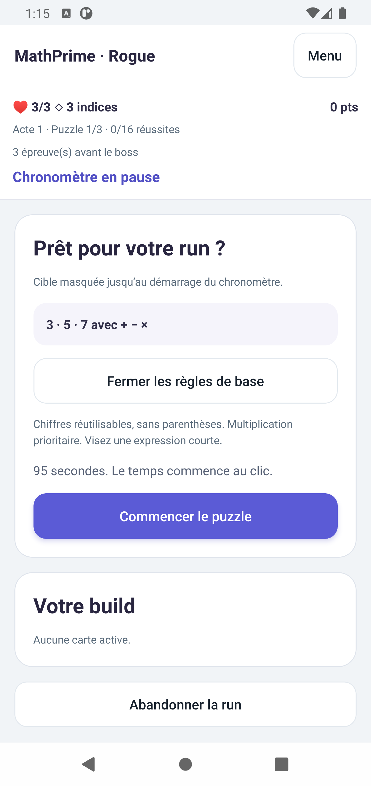
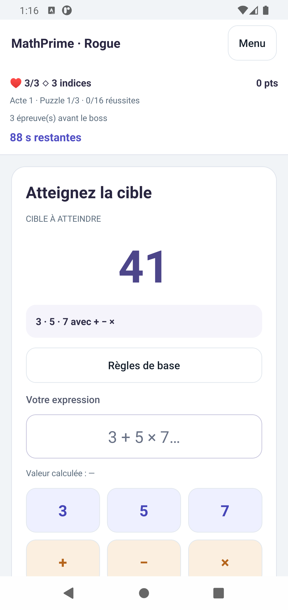
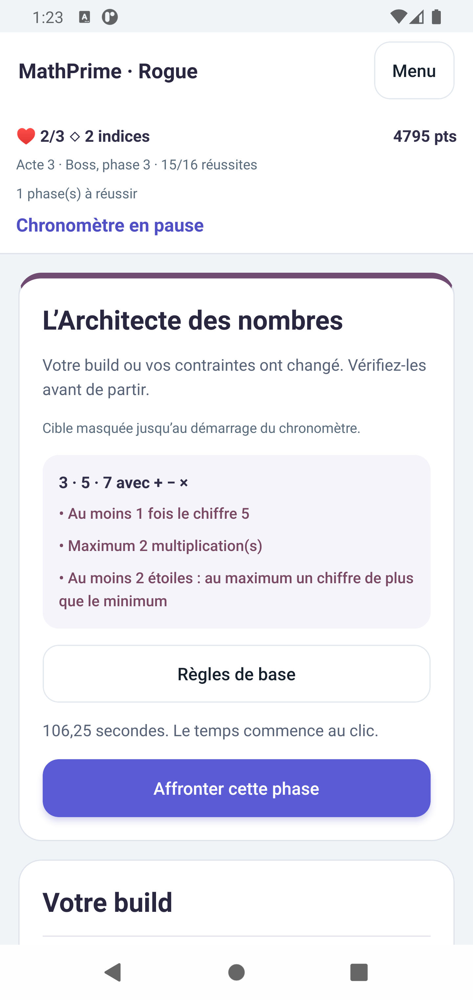
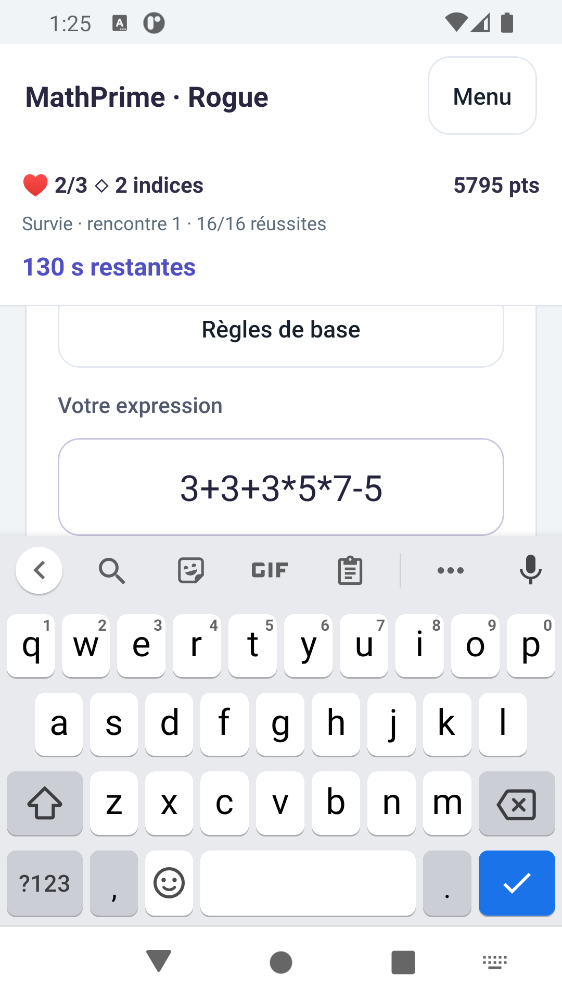
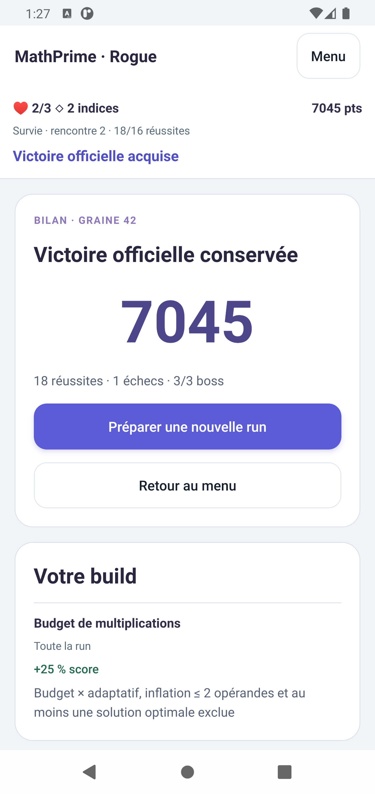

# R3.2.2 — Cibles masquées et temps de jeu Rogue

Correctif du 14 novembre 2026 sur `feat/rogue-v1-mobile-persistence`, à partir de `092f23b` (arbre initial propre), pour la PR #11 vers `modernization`. Aucun travail R4, changement Supabase, Daily, profil ou autre mode.

## Préparation et révélation

La projection partagée distingue `state: "preparation"` et `state: "playing"`. Pendant la préparation, l'objet n'a **aucune propriété `target`** ; le temps restant vaut zéro, sans rappel de chronomètre. Les règles, contraintes, budget initial, cartes et ressources restent disponibles. La solution témoin, les statistiques de solutions et les diagnostics du générateur restent hors de cette projection.

Le puzzle est généré avant le clic. `start` réutilise ce puzzle, démarre le chronomètre et publie ensemble l'état actif et sa cible. Aucune nouvelle recherche ne retarde le démarrage. Web et Android rendent la cible uniquement dans cet état. Le rendu interactif CLI masque également la cible en préparation.

Les règles de base sont ouvertes au début, puis consultables à la demande. Les préparations ordinaires sont compactes. Une courte explication accompagne un nouvel acte, un boss, l'entrée en survie ou un changement de contraintes/build. Les phases suivantes ne répètent pas l'introduction du boss. La diminution d'un compteur de carte ne déclenche pas à elle seule une présentation.

La garantie porte sur l'interface et sa projection : le checkpoint interne conserve la cible nécessaire au rejeu. Une graine déterministe et un stockage local ne constituent pas un système anti-triche.

## Durées et effets temporels

| Paramètre | Avant | Après |
| --- | --- | --- |
| Bases par difficulté 1 à 5 | 35 / 45 / 60 / 75 / 90 s | **95 / 105 / 115 / 125 / 135 s** |
| Plancher effectif après modificateurs | 25 s | **60 s** |
| Plafond | 120 s | **180 s** |
| Érosion temporelle de survie | −2 s par rencontre après la première, sans limite | Même pente, **maximum −40 s** à partir de la rencontre 21 |

L'ordre de calcul reste : `(base + secondes des cartes + report − érosion de survie) × facteurs des cartes × facteur du boss`, puis bornage. Les dix premières secondes supplémentaires entre difficultés évitent une forte inflation en fin de parcours.

| Rencontre sans carte ni report | Avant | Après |
| --- | --- | --- |
| Acte 1, puzzles ordinaires | 35 s | 95 s |
| Boss 1, phases 1 et 2 | 45 s | 105 s |
| Acte 2, puzzles ordinaires | 45 s | 105 s |
| Boss 2, deux phases | 60 s | 115 s |
| Acte 3, puzzles ordinaires | 60 s | 115 s |
| Boss 3, phases 1 et 2 | 75 s | 125 s |
| Boss 3, phase finale (×0,85) | 63,75 s | 106,25 s |
| Survie, rencontre 1 | 90 s | 135 s |
| Survie, rencontre 21 | 50 s | 95 s |
| Survie très lointaine | 25 s au plancher | 95 s, érosion plafonnée |

| Combinaison | Avant | Après | Effet préservé |
| --- | --- | --- | --- |
| Difficulté 1 + T1 | 29,75 s | 80,75 s | −15 % |
| Difficulté 1 + T2 | 50 s | 110 s | +15 s |
| Difficulté 1 + T5 | 25 s | 85 s | −10 s |
| Difficulté 1 + E3 | 47 s | 107 s | +12 s |
| Boss 1 phase 2 après réponse optimale | 53 s | 113 s | +8 s |
| Difficulté 1 + T1 + T5 + report D4 II de −12 s | 25 s (borné) | **62,05 s** | Pénalités conservées, sans écrasement au plancher |
| Boss 3 final + mêmes modificateurs | 38,2925 s | 74,4175 s | Double facteur ×0,85 conservé |
| Survie ≥21 + mêmes modificateurs | 25 s (borné) | **62,05 s** | T1, T5 et D4 gardent un effet |
| Survie 1 + T2 + E3 + report D4 II de +12 s | 120 s (borné) | 174 s | Les bonus se cumulent sans être écrasés |

| Acte, rencontre ordinaire | T1 + T5 + report −12 s | T2 + E3 + report +12 s |
| --- | --- | --- |
| Acte 1 (borne conservatrice) | 62,05 s | 134 s |
| Acte 2 | 70,55 s | 144 s |
| Acte 3 | 79,05 s | 154 s |

Le cas difficulté 1 avec D4 II est une borne conservatrice, même lorsque l'ordre d'acquisition réel ne permet pas ce build à ce stade. Les tests parcourent les 16 sous-ensembles de cartes temporelles, les reports ±8/±12 s, le bonus de rythme cumulé (+20 s), toutes les phases et la survie lointaine. Chaque ajout d'une carte temporelle garde son sens strict : bonus augmentant le temps, pénalité le diminuant. Le maximum réel de ces combinaisons valides est 174 s ; le plafond de 180 s n'efface aucun bonus testé.

Sans plafonnement de l'érosion de survie, tout build finirait au plancher et plusieurs cartes temporelles deviendraient sans effet. La limite de 40 s répond directement à ce problème ; les règles mathématiques et la pression des obligations de survie restent inchangées. Aucun changement des scores, étoiles, récompenses, pools ou limites de recherche.

Ces durées sont une proposition de gameplay à éprouver avec des joueurs. Le coût heuristique du générateur reste un diagnostic informatique, sans validation humaine. Solvabilité mathématique, minimum connu dans les bornes et confort humain restent des notions distinctes.

## Sauvegardes et contrat de rejeu

Format d'enveloppe conservé : **2**. Nouveau contrat : **`rogue-v1-r3.2.2-1`** au lieu de `rogue-v1-r3.2-1`.

Une ancienne expiration à 35 s n'expirerait plus au même instant sous les nouvelles règles. Rejouer son journal avec les nouvelles durées modifierait vies, cartes, score et suite de run. Une migration générale fiable nécessiterait de conserver le moteur temporel historique puis de définir une frontière de conversion. Ce correctif refuse donc explicitement l'ancien contrat, sans réécrire ni supprimer ses données.

Web et Android affichent l'incompatibilité avec les nouvelles durées. Annuler le remplacement conserve l'ancienne session, y compris après rechargement/destruction du processus. Seule la confirmation de « Remplacer » écrit une nouvelle run. Les enveloppes de format 1 sans contrat explicite sont également incompatibles ; seul un format 1 déclarant le contrat actuel peut subir la migration structurelle existante. Trois fixtures synthétiques ont été produites avec le code historique `092f23b` : préparation, jeu à 5 s et expiration à 35 s. Les tests vérifient leur conservation et celle du profil indépendant.

Les sessions du nouveau contrat restaurent une préparation toujours masquée, sans temps consommé hors écran. Un puzzle actif retrouve sa cible et son temps restant, interruptions comprises. Résultats, pénalités et récompenses ne sont appliqués qu'une fois. Les mécanismes R3.2 de verrouillage, écriture complète et publication après acquittement sont conservés. Le temps d'écriture après acceptation de `start` compte dans le chronomètre ; le test de stockage artificiellement bloqué cinq secondes publie cible et temps actif ensemble à 90 s sur un budget de 95 s. Le stockage local n'offre pas une horloge de confiance ni une transaction avec le rendu graphique.

## Contrôles automatisés exécutés

- `npm test` : **123 réussites**, zéro échec (106 moteur, 12 Web, 5 mobile).
- Typechecks moteur, Web et mobile : réussis, y compris les tests/contrats inclus dans leurs scripts.
- `npm run build -w @shortest/web` : réussi.
- Android natif : `:app:assembleRelease -PreactNativeArchitectures=x86_64 --max-workers=2 --no-daemon --console=plain`, Java 17 via `mise`, SDK explicite. **BUILD SUCCESSFUL en 59 s**, puis confirmation sur les sources finales en **1 min 5 s**, 529 tâches. APK autonome installé avec `adb install -r`, données conservées.
- `git diff --check` : réussi.

Les nouveaux tests couvrent absence de cible dans toute la projection et dans le HTML Web, révélation/chronomètre, absence de génération au démarrage, budget ≥60 s, utilité marginale des cartes temporelles, trois actes, toutes les phases de boss, victoire et survie, préparation restaurée et contrat historique. Les tests existants des douze cartes, indices partiels, assurances, consommations, score, échéances et reprises restent réussis.

## Validation visuelle réellement effectuée

### Web

Navigateur intégré, site local puis build Vite compilé. Ancienne sauvegarde incompatible : confirmation annulée puis rechargement, notice encore présente. Remplacement confirmé ; première préparation à 95 s, sans cible, règles ouvertes. Rechargement/Continuer retrouve la préparation masquée. Le clic révèle 41 avec 95 s et la saisie disponible.

Interruption/reprise réelle : retour avec 3 s restantes, puis expiration à 95 s. Deux vies après expiration, encore deux après rechargement/Continuer. Trois réussites ordinaires, choix tactique, boss 1 en deux phases ; préparation du boss masquée à 105 s, puis 113 s après le bonus optimal. Indice partiel demandé sans révélation complète. Boss vaincu, récompense majeure E3 choisie : acte 2 masqué à 117 s, un indice, trois tentatives d'effet ; même état après rechargement, sans double prélèvement. Règles consultées à nouveau.

Le serveur de développement a été interrompu avec le code 143 pendant cet essai. La validation a repris sur le build compilé, dans un nouvel onglet de même origine, avec la session conservée. Ce défaut de l'environnement de test n'est pas compté comme un parcours applicatif réussi.

### Android natif

Pixel_4_XL, Android 11 / API 30 / x86_64, 1440 × 3040 px, densité 560. Pilotage réel par ADB, captures et hiérarchie UIAutomator. APK release autonome, sans dépendance à Metro. Ancienne session signalée incompatible ; annulation, destruction du processus et relance conservent la notice. Profil d'accueil toujours à 75 XP, rang 2. Remplacement confirmé avec seed 42.

Préparation masquée à 95 s, règles ouvertes et bouton accessible. Menu/confirmation/Continuer conservent la préparation. Démarrage : cible 41 et 95 s. Saisie native avec clavier visible et champ dégagé. Destruction du processus puis relance/Continuer : **87 s**, même cible. Arrière-plan jusqu'à expiration réelle ; une seule vie perdue, résultat inchangé après un autre arrêt/relance.

Parcours réel des **16 rencontres**, trois boss vaincus et victoire officielle à **5 795 points**, puis deux réussites en survie jusqu'à **7 045 points**. T4, T1, E2, D2 et E1 choisis au fil des récompenses ; T1 donne notamment 89,25 s à l'acte 2. Préparations contrôlées sans cible à toutes les rencontres, y compris les trois phases de l'Architecte ; saisie des réponses après révélation uniquement. Un solveur a assisté le pilote à partir de la cible et des contraintes déjà visibles : ce contrôle vérifie le fonctionnement, pas la difficulté humaine.

Menu/confirmation/Continuer entre plusieurs réponses, notamment aux boss, sans changement de cible ni réinitialisation du temps. Un indice consommé sur le premier succès reste partiel. Même processus **PID 21475** pendant les transitions du parcours ; buffer de crash vide. Les corrections Fabric et clavier de R3.2.1 sont préservées.

Essai **360 × 640 dp** (1080 × 1920 px, densité 480) : règles consultées, préparation de survie masquée à 135 s, bouton atteint par défilement, champ dégagé au-dessus du clavier, réponse validée. Taille/densité ensuite remises à zéro. Deuxième survie à 133 s, insertion du dernier chiffre par une touche native avec conservation de l'expression, puis validation. Retour Android et annulation de la confirmation vérifiés. Sortie de survie confirmée : bilan **18 réussites, un échec, trois boss, 7 045 points, victoire conservée**.

Nouvelle installation de l'APK final par remplacement, arrêt du processus et réouverture du dernier bilan : même score et mêmes compteurs, sans double récompense. SHA-256 de cet APK : `788b73b4e6736b1e8352e3e8a0a1ae93d0746ae836c1165da0b0fad5a822f6fb`. L'APK n'est pas ajouté à Git. L'émulateur reste ouvert sur le bilan, sans chronomètre actif ; les fichiers temporaires du pilote ont été retirés.

Transparence : le pilote a d'abord cherché un libellé d'indice inexact, puis choisi le mauvais libellé de démarrage lorsque le bouton d'une phase de boss était hors champ. Ces essais ont été corrigés et repris depuis les états conservés ; ils ne sont pas comptés comme des transitions validées. Aucun défaut applicatif supplémentaire ni nouveau crash n'a été constaté. Le bilan final ne contient que l'expiration volontaire initiale.

## Captures

## Limites

Validation native sur cet AVD Android 11 x86_64 ; aucun appareil physique, ARM64 ou Android récent. Les combinaisons temporelles extrêmes sont couvertes par les tests moteur, pas toutes par acquisition tactile. Les garanties et limites locales de [R3.2](R3.2-rogue-mobile-persistence.md) demeurent, avec le nouveau contrat précisé ici. Aucun test manuel complet des autres modes ou de Supabase n'est revendiqué.
