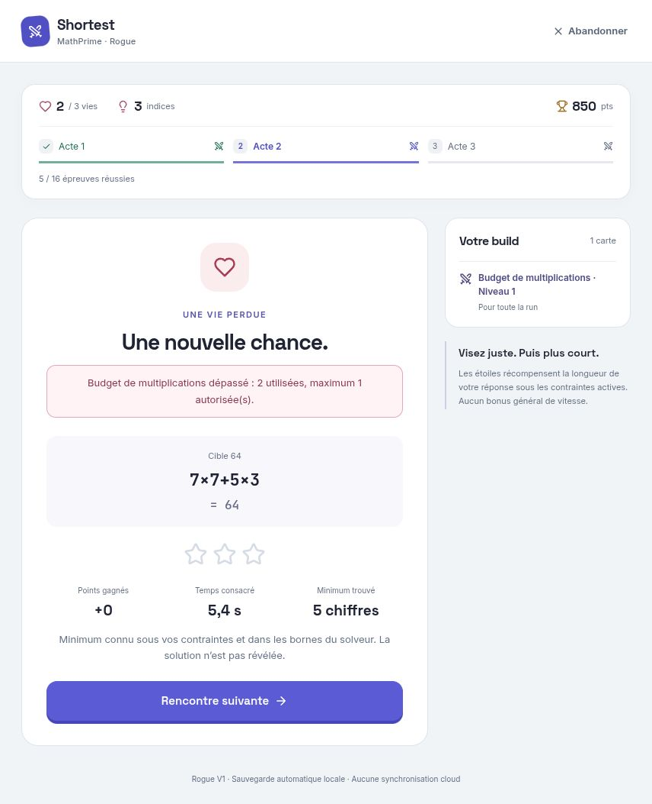
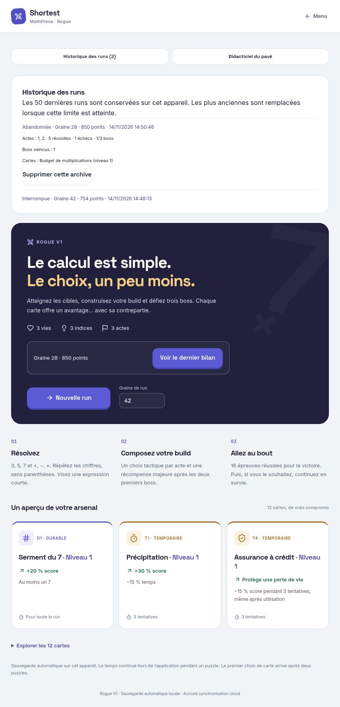
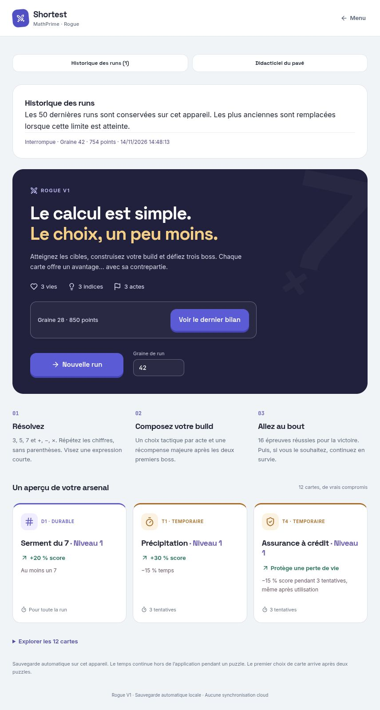
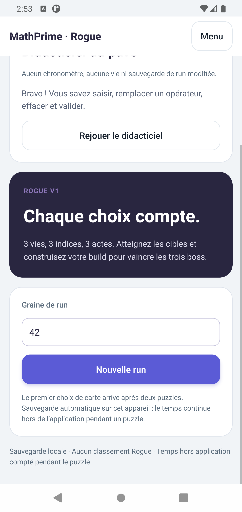
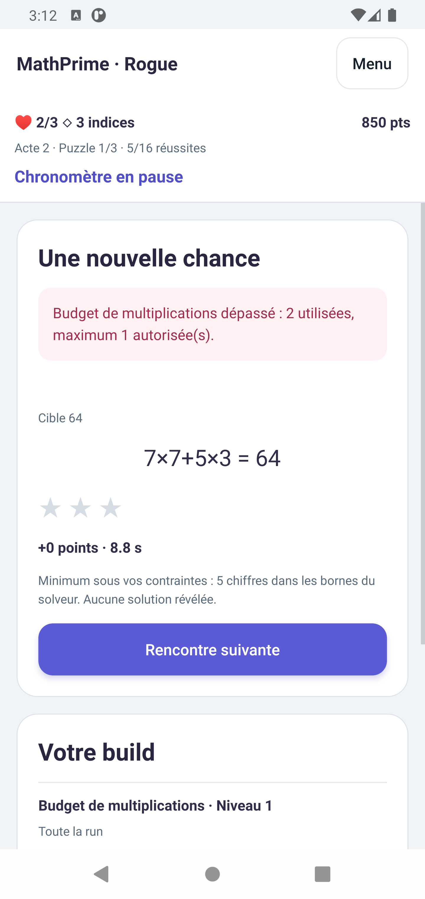
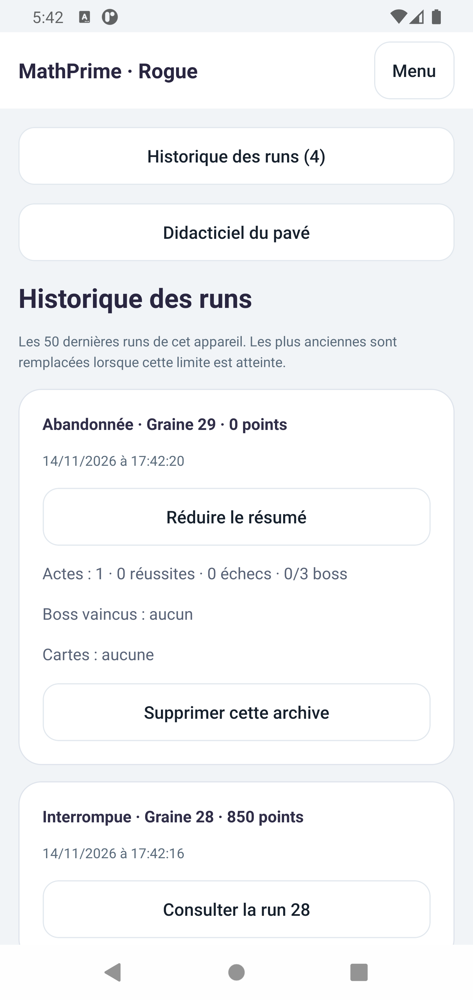
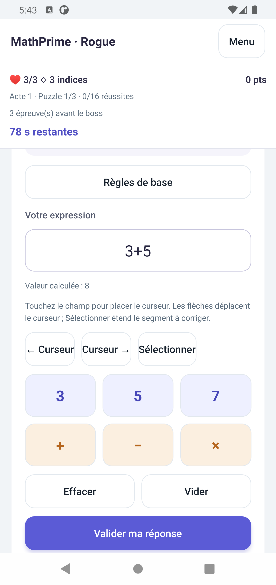
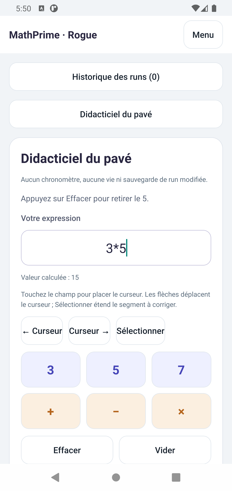
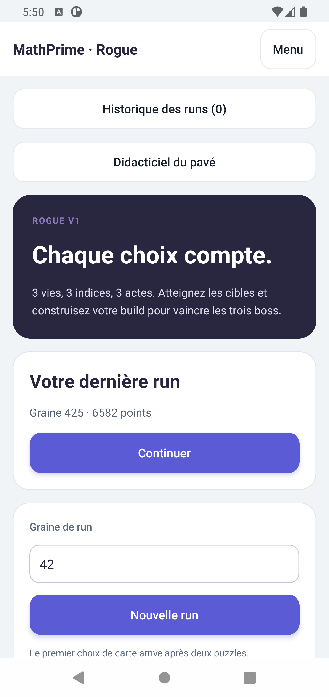

# R4.1 — Qualité de vie Rogue et historique local

Validation du 14 novembre 2026. Base propre : `modernization`, `9bd702f`, après vérification de la fusion de la PR #11 et de la CI verte sur ce commit. Branche : `feat/rogue-r4-1-quality-of-life`. Aucun changement d'équilibrage, de score, de génération, de récompenses, de Daily, de Supabase ou des autres modes.

## Historique et cohérence des écritures

Les archives sont des **résumés locaux**, distincts de la session active. Chaque entrée contient l'identifiant stable de la session, sa date, sa seed, son score, les actes atteints, les réussites et échecs, les boss vaincus, les cartes acquises et leur niveau maximal rencontré, ainsi qu'un statut. Les cartes expirées ou remplacées restent dans ce résumé. Aucune cible, solution témoin ni journal de rejeu n'est recopié dans une archive.

Une run terminée est archivée automatiquement, y compris une dernière vie perdue avant de fermer l'écran de résultat. La victoire officielle peut être poursuivie en survie : cette phase appartient à la même run et au même identifiant, et son résumé final est enregistré à la conclusion. Si une partie encore inachevée est remplacée, son statut d'archive est **Interrompue**, sans l'annoncer comme victoire ou défaite définitive. Un abandon avant victoire est distingué d'une défaite ; la victoire acquise reste conservée après une sortie de survie.

L'historique se consulte depuis l'accueil Rogue sur les deux plateformes. Chaque entrée peut être développée puis supprimée après confirmation. Annuler ne change rien. Supprimer une archive conserve la session active, son dernier bilan et les autres résumés. Un marqueur d'archivage de la session active empêche de recréer une archive supprimée lors de la réouverture du même bilan.

### Format et migration

- Nouvelle clé canonique : **`shortest:rogue:store`**, enveloppe **version 1** : `active`, `archives`, `activeArchived`.
- Session interne : format **2**, contrat **`rogue-v1-r3.2.2-1`**, tous deux inchangés. Les règles et les journaux existants R3.2.2 restent rejouables.
- Limites : **50 résumés**, taille totale bornée à 3 200 000 caractères, dont le journal actif conserve sa limite R3.2. Les entrées les plus anciennes sont retirées à saturation, politique annoncée dans l'interface. Identifiants, dates, compteurs, statuts, cartes et unicité sont validés.
- À la première lecture, l'ancienne clé `shortest:rogue:session` est copiée sous verrou dans l'enveloppe canonique. La source est conservée comme **unique copie de récupération en lecture seule**, sans mises à jour ni multiplication de journaux dans les archives. Elle n'est plus utilisée lorsque le magasin canonique existe. Cela conserve les octets source, y compris pour une ancienne session incompatible ou invalide.
- Une ancienne session déjà terminée reçoit un résumé une seule fois. Sa date est celle de la dernière sauvegarde historique, pas celle du jour de migration. Pour une interruption par remplacement, la date est celle du remplacement.
- Un magasin canonique corrompu ou de version future bloque les écritures ; il n'est ni effacé ni remplacé par une ancienne copie. Les incompatibilités antérieures à R3.2.2 restent explicites, avec remplacement confirmé comme auparavant.

### Atomicité et reprise

La nouvelle session et le résumé de celle qu'elle remplace sont écrits **dans une seule valeur**, sous le verrou Web Locks ou le verrou du processus natif. `localStorage.setItem` remplace une valeur entière ; l'adaptateur Android utilise `AsyncStorage.setItem`, dont le stockage natif transactionnel est conservé. La comparaison avec la dernière valeur lue empêche une instance périmée d'écraser la progression d'une autre.

Avant l'écriture atomique, l'ancienne session reste intégralement présente. Après l'écriture, la nouvelle session et l'archive de l'ancienne sont présentes ensemble. Il n'existe pas de fenêtre où seule l'une des deux a été enregistrée. La publication à l'interface attend l'acquittement. Sur erreur, les actions sont bloquées et l'état durable reste la référence. Une erreur avant écriture se reprend par réessai ; en cas d'acquittement perdu après écriture, un rechargement retrouve l'enveloppe complète. Un conflit impose le rechargement plutôt qu'un écrasement.

La suppression remplace la même enveloppe en ne retirant qu'un résumé. Les tests injectent les interruptions avant écriture, après écriture mais avant acquittement, pendant un remplacement, pendant une conclusion et lors d'une suppression. Ils vérifient aussi les conflits entre contrôleurs, la borne de rétention et l'absence de réapparition d'une archive supprimée.

## Saisie et didacticiel

Android utilise un `TextInput` sélectionnable avec `showSoftInputOnFocus={false}`. Les menus contextuels sont masqués et une modification extérieure est refusée : la réponse se construit par le pavé, Effacer et Vider. Le focus programmatique des touches conserve le curseur sans ouvrir Gboard. Un essai d’injection extérieure avait fait apparaître le clavier malgré le rejet du texte : ce cas ferme maintenant explicitement le clavier, puis restitue le focus et la sélection. Le contrôle final vérifie `3*`, le rejet du chiffre extérieur `9`, puis l’ajout tactile de `5` donnant `3*5`, sans Gboard. Toucher le champ positionne le curseur ; deux flèches permettent de l'affiner et le bouton Sélectionner permet de sélectionner puis d'étendre un segment à remplacer. Les protections Fabric R3.2.1 (`removeClippedSubviews={false}`, parent de touches non collapsable) restent en place.

La fonction pure `editExpression` est partagée entre Web et Android. Elle conserve la sélection et la position finale du curseur, respecte les opérateurs autorisés et gère l'effacement et la remise à zéro. Avec un curseur seul, un opérateur remplace celui juste avant lui, ou celui situé sous le curseur au milieu d'une expression. Une sélection explicite est remplacée telle quelle, sans consommer un caractère extérieur à la sélection. Une saisie d'opérateur sans chiffre à gauche est ignorée. Les collages Web ne sont pas réécrits silencieusement. Les touches du pavé Web et les touches physiques d'opérateurs réutilisent la même logique ; la priorité mathématique ne change pas.

Aucun didacticiel existant n'a été trouvé dans les deux applications. Un module Rogue rejouable réutilise les vrais composants de saisie, avec une séquence commune : saisir `3+`, remplacer `+` par `×`, ajouter `5`, l'effacer, ajouter `7` puis valider. Les étapes dépendent des modifications réelles, sans chronomètre, consommation de ressource ou écriture de run.

## Diagnostics et descriptions des cartes

La validation mathématique existante demeure inchangée. Un diagnostic typé décrit les raisons du refus : syntaxe, chiffre ou opération interdite, occurrences obligatoires, soustraction obligatoire, budget de multiplications, borne de calcul intermédiaire, cible et précision en étoiles. Les tests confrontent les diagnostics au validateur existant sur plusieurs règles, expressions et bornes. Les valeurs utilisées et autorisées sont fournies, avec un message principal et les autres erreurs consultables. Aucune solution optimale n'est divulguée.

Le cas demandé est vérifié sur les deux plateformes : **cible 64, `7×7+5×3`, budget d'une multiplication → « Budget de multiplications dépassé : 2 utilisées, maximum 1 autorisée(s). »** La perte de vie reste celle du moteur. Un diagnostic de résultat est reconstruit après restauration ; une erreur de syntaxe reste transitoire, sans journaliser un texte invalide arbitraire.

D2 présente désormais le bénéfice, la contrepartie, le niveau, la durée et la limite réellement applicable. Le niveau II conserve **+35 % de score au lieu de +25 %**, et retire une multiplication au budget du niveau I ; **zéro est possible** aux difficultés basses. Les offres annoncent la limite de la prochaine épreuve ; le build affiche celle du puzzle préparé/actif. Les explications sur les filtres du générateur restent dans une aide avancée facultative. Aucun effet réel de carte n'a été modifié.

## Contrôles automatisés

| Contrôle exécuté | Résultat |
| --- | --- |
| `npm test` | **143 réussites**, aucun échec : moteur 122, Web 15, mobile 6 |
| Typechecks moteur, Web et mobile | Réussis, avec les contrats et tests inclus par leurs scripts |
| `npm run build -w @shortest/web` | Réussi |
| Android `:app:assembleRelease -PreactNativeArchitectures=x86_64 --max-workers=2 --no-daemon --console=plain` | **BUILD SUCCESSFUL**, compilation initiale 58 s, confirmation sous l'identifiant normal 1 min 35 s, puis APK final renforcé 1 min 15 s, 529 tâches |
| Installation Android | APK autonome réellement installé et exécuté, sans effacement des données |
| `git diff --check` | Réussi |

SHA-256 de l'APK final normal, non ajouté à Git : `d4df5303cb6473d47169c14ffd58cabb7ad55799d13fd85785d28095849aabdf`.

Les tests existants des douze cartes, trois boss, durées R3.2.2, victoire, survie, indices, sauvegardes et autres modes restent réussis. Les nouveaux tests couvrent les statuts d'archives, cartes expirées, migration, écritures interrompues et suppression, saisie/curseur, didacticiel, diagnostics et contraintes D2 dynamiques, ainsi que la préservation du profil indépendant.

## Validation Web effectuée

Le build local a été testé dans le navigateur intégré. La session R3.2.2 de graine 42 est reprise avec **754 points**, deux vies, un indice, E3 et une préparation à **117 s** sans cible. Menu/confirmation/retour puis didacticiel complet et rejeu sont vérifiés. Le clavier physique remplace également le `+` de `3+` par `*`, sans créer deux opérateurs.

Remplacement confirmé par une run de graine 28 : l'ancienne run devient une archive **Interrompue**, toujours à 754 points. Trois puzzles ordinaires, refus du choix tactique, puis les deux phases du premier boss sont joués. D2 est choisi : affichage du niveau I, +25 %, durée permanente et limite d'une multiplication. Le cas 64 produit le diagnostic précis, à 850 points et deux vies. L'abandon archive la run comme **Abandonnée** avec cinq réussites, un échec, un boss et D2.

Les deux archives sont consultées. Suppression de la seule archive de test 28 : annulation d'abord, puis confirmation ; l'entrée 42 est conservée. Après rechargement et réouverture du dernier bilan, l'archive supprimée ne revient pas, tandis que le bilan actif 28 reste disponible.

## Validation Android effectuée

Omarchy Linux, SDK local, Java 17 via `mise`, AVD **Pixel_4_XL Android 11 / API 30 / x86_64**, 1440 × 3040 px, densité 560. Interactions réelles par ADB, captures et UIAutomator ; il ne s'agit pas d'un simple export Hermes.

Une partie plus récente avait été jouée depuis R3.2.2 : **graine 425, 6 582 points, encore en cours**. Son résumé est resté présent après installation et migration. Les remplacements et suppressions ont été testés dans un APK temporaire à identifiant distinct, `com.shortest.r41validation`, compilé avec une surcharge Gradle temporaire hors dépôt (**54 s**, 529 tâches). Aucune logique spéciale de jeu ni de stockage n'a été ajoutée au produit pour les essais ; les données de l'application principale restent séparées.

- Didacticiel tactile terminé et rejoué ; champ touché, opérateurs remplacés, correction d'un chiffre et d'un segment sélectionné, Effacer et Vider vérifiés. Contrôle de `mInputShown` et captures : Gboard reste fermé.
- Parcours de graine 28 : trois puzzles ordinaires, les deux phases du premier boss, choix D2 puis diagnostic de la cible 64 saisi uniquement avec les commandes de jeu. Le processus reste stable sur les transitions ; buffer de crash vide.
- Menu/confirmation/Continuer pendant une épreuve, changement de puzzle et reprise : le pavé et le champ ne rouvrent pas Gboard.
- Partie 28 à 850 points remplacée par 29 : archive **Interrompue**. Abandon de 29 : archive **Abandonnée**. Consultation des résumés, annulation de suppression puis suppression de 29 : **quatre → trois archives**, les deux autres entrées de graine 28 provenant des essais du pilote étant conservées.
- Arrêt du processus et réouverture du bilan 29 : bilan actif disponible, archive 29 toujours supprimée. Une nouvelle run 30 reste saisissable après arrêt/relance : **89 → 78 s**, sans remise à zéro et sans Gboard. Le texte non soumis n'est pas restauré, conformément au contrat existant. Cette run de test est ensuite abandonnée proprement.
- L'APK final normal est réinstallé sans effacement ; le champ et le pavé sont retestés dans le didacticiel, avec rejet d'une saisie extérieure. La partie principale de graine 425 reste à 6 582 points, sans être remplacée ni relancée.

Les premiers pilotes cherchaient un bouton hors champ, lisaient le texte indicatif d'un champ vide comme s'il s'agissait d'une valeur, ou effectuaient les gestes de défilement dans le champ de réponse. Deux runs isolées ont expiré pendant ces essais. Le pilote a été corrigé, puis les contrôles ont été repris. Ces essais ne sont pas présentés comme des réussites ni comme des défauts applicatifs. Aucun nouveau crash Fabric n'a été constaté. L’installation Android temporaire est retirée à la fin ; seul l’APK normal demeure installé, sur l’accueil Rogue avec la partie 425 préservée.

## Limites

Historique et sessions restent propres à chaque installation/origine, sans synchronisation cloud ni restauration jouable depuis un résumé. La rétention concerne 50 résumés, pas une sauvegarde illimitée. La copie source R3.2.2 de récupération est conservée séparément ; supprimer une archive ne supprime pas cette copie de migration ni le bilan actif. Les anciennes versions de l'application ne doivent pas être utilisées en parallèle après migration ; les nouvelles instances restent protégées par comparaison sous verrou.

Validation native sur un AVD Android 11 x86_64, sans appareil physique, ARM64, Android récent ou autre clavier. Les combinaisons de cartes et toute la survie sont couvertes par les tests moteur ; le parcours natif R4.1 ne rejoue pas les seize rencontres déjà validées en R3.2.2. Les interruptions au milieu d'une écriture sont injectées en tests automatisés ; le contrôle manuel du processus porte sur des états dont l'acquittement a été observé. Aucun parcours manuel complet Daily ou Supabase n'est revendiqué.

## Captures

