# R4.3A — Notes des captures actuelles

Captures prises pendant cet audit depuis le code `c6983da`, dans une origine Web et un identifiant Android de test distincts. Les captures des jalons précédents ne servent pas de preuve de l’état actuel.

## 1. Accueil Rogue — lisible, fidélité artistique partielle

[Web](assets/R4.3A/web-01-home.jpg) · [Android](assets/R4.3A/android-01-home.png).

Voir les captures de cette étape

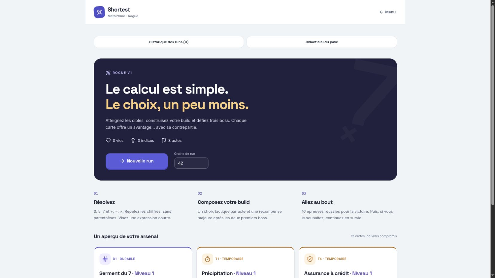

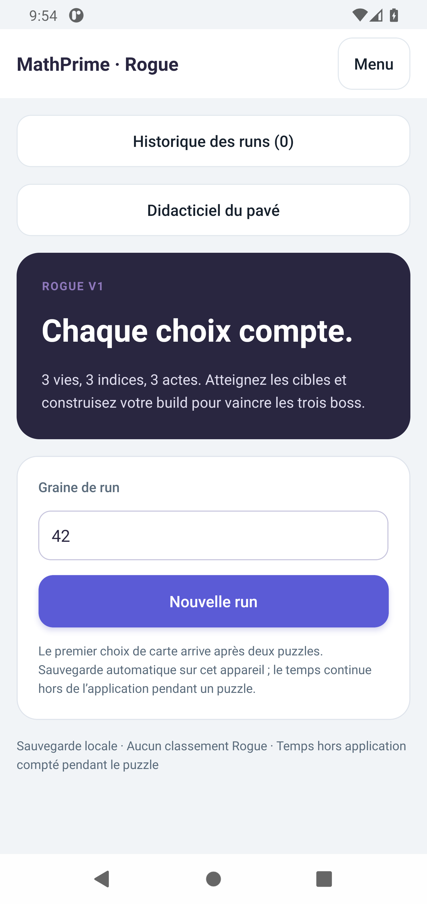

Hiérarchie et action principale nettes, surfaces arrondies et bloc sombre déjà présents. L’ivoire, le corail et le bleu nuit de référence ne sont pas reproduits : fond gris froid, accent violet, aucune mascotte. Identité affichée différente entre Web (« Shortest ») et Android (« MathPrime · Rogue »). Historique et didacticiel sont de nouveaux accès à conserver, sans maquette dédiée retrouvée. La capture Web montre le haut du contenu défilant, pas l’arsenal entier.

## 2. Didacticiel — fonction accessible, longueur à adapter

[Web](assets/R4.3A/web-02-tutorial.jpg) · [Android](assets/R4.3A/android-02-tutorial.png).

Voir les captures de cette étape

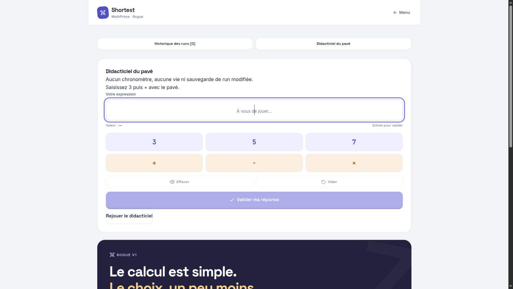

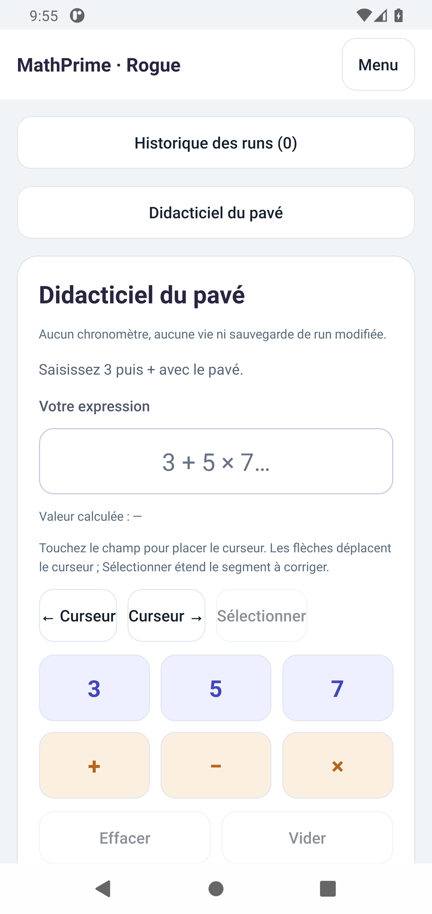

Exercice sans chronomètre ni vie, consigne explicite, curseur et distinction Effacer/Vider conservés. Le focus Web est visible. Sur Android, les instructions et la rangée de sélection occupent assez de hauteur pour placer la validation sous le premier écran : le défilement doit rester possible, et une intégration artistique ne doit supprimer aucune aide de saisie pour gagner de la place. Les boutons désactivés sont visuellement atténués. Pas de maquette dédiée du didacticiel retrouvée ; réutiliser le langage de la référence mobile « aide modifier calcul » sans retirer le parcours interactif.

## 3. Préparation sans cible — invariant respecté

[Web](assets/R4.3A/web-03-preparation.jpg) · [Android](assets/R4.3A/android-03-preparation.png).

Voir les captures de cette étape

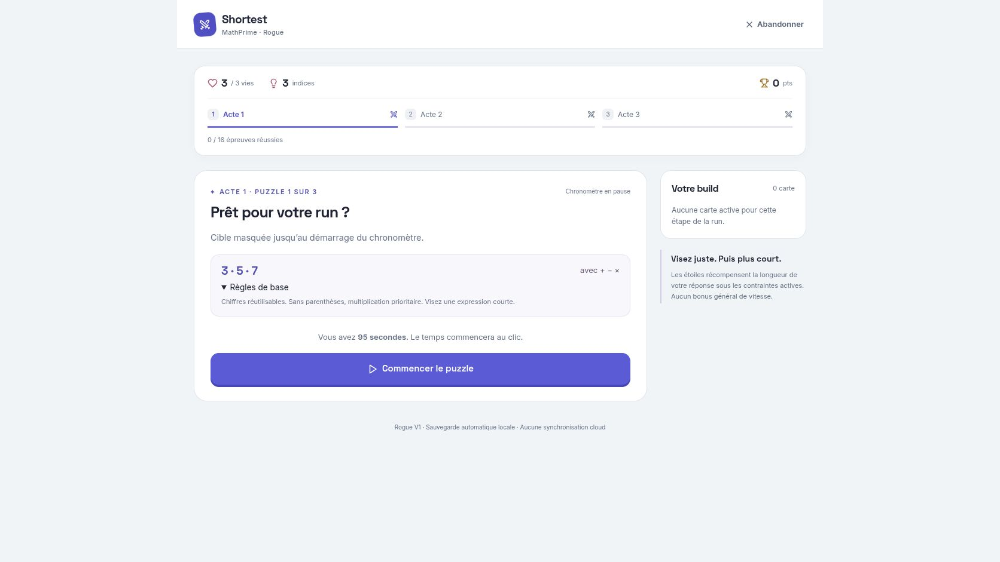

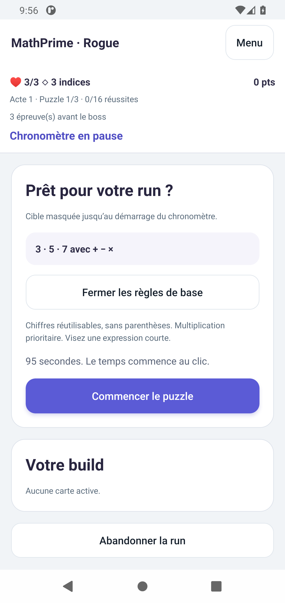

La cible n’apparaît pas, la durée allouée est annoncée et le démarrage est explicite. La hiérarchie est utilisable et les règles de base sont consultables. Android consacre un grand bloc fixe aux vies, indices, acte et chronomètre : ce volume doit être pris en compte pour le pavé à l’étape suivante. Le futur habillage bleu nuit doit conserver un état masqué réellement distinct, et ne pas recopier un chiffre décoratif d’une ancienne maquette en guise de cible.

## 4. Puzzle actif et pavé — utilisable, défilement mobile à réduire

[Web](assets/R4.3A/web-04-active.jpg) · [Android haut](assets/R4.3A/android-04-active-top.png) · [Android pavé](assets/R4.3A/android-04-active-pad.png).

Voir les captures de cette étape

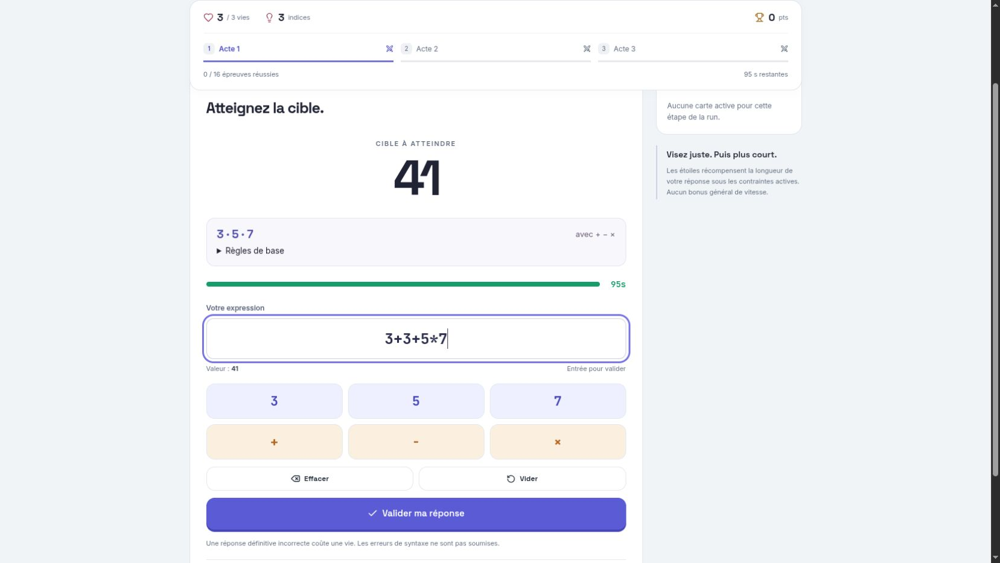

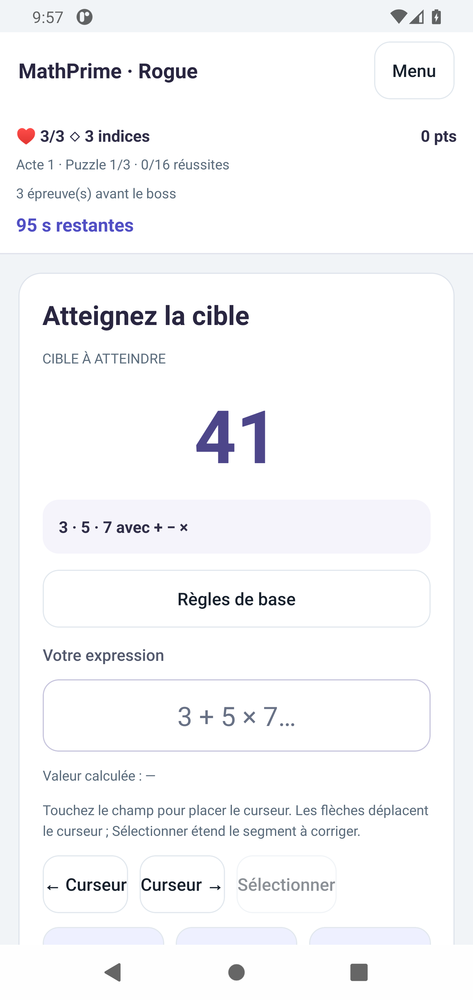

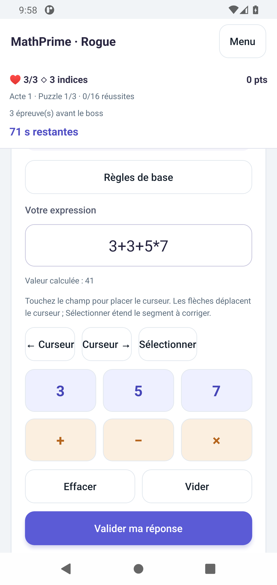

Cible et calcul lisibles, focus/curseur visibles, chiffres 3/5/7, Effacer/Vider distincts. Le rappel mathématique est replié dans les règles, alors que les références le placent en permanence avant la cible. Sur Android, la cible, les instructions et les commandes de sélection imposent de défiler jusqu’au pavé ; la comparaison avec la maquette mobile 06 confirme une perte de simultanéité cible/saisie. Le HUD fixe garde le temps visible. Réduire les volumes de présentation en R4.3B, sans supprimer la sélection, changer les callbacks, réactiver le clavier système ou retirer les corrections Fabric. La disposition Web n’utilise pas encore la composition cible/calcul à gauche et pavé à droite de la référence web 06.

## 5. Résultat de puzzle — feedback clair, identité à harmoniser

[Web](assets/R4.3A/web-05-result.jpg) · [Android](assets/R4.3A/android-05-result.png).

Voir les captures de cette étape

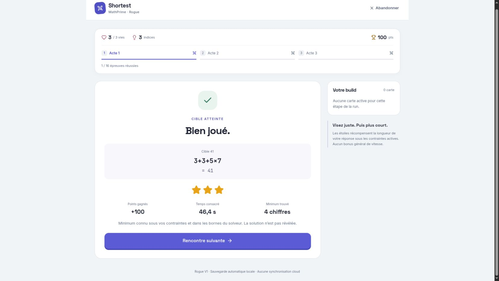

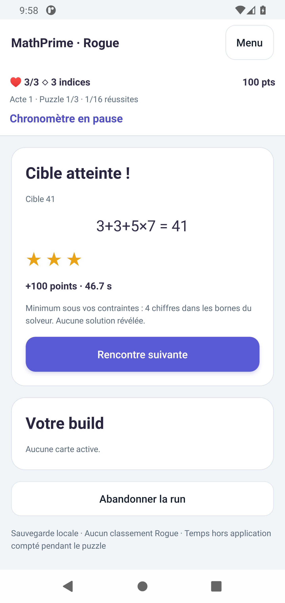

Réponse, étoiles, points et minimum borné sont distingués ; aucun témoin du solveur n’est ajouté à l’interface. L’action de continuation est explicite. Le vert de réussite et les cartes blanches fonctionnent comme feedback, mais diffèrent de l’univers ivoire/aubergine/or des références. Conserver les informations de minimum « dans les bornes », absentes des premières maquettes. Le temps affiché correspond au pilotage d’audit et ne mesure pas une performance humaine.

## 6. Cartes — coûts explicites, comparaison mobile coûteuse

[Web](assets/R4.3A/web-06-cards.jpg) · [Android](assets/R4.3A/android-06-cards.png) · [Suite Android](assets/R4.3A/android-06-cards-bottom.png).

Voir les captures de cette étape

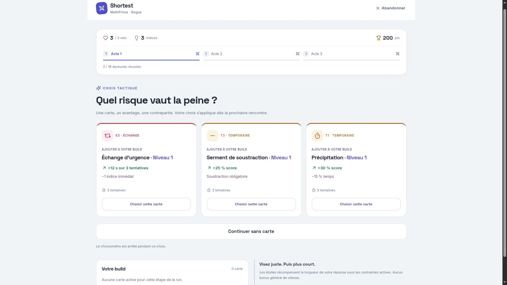

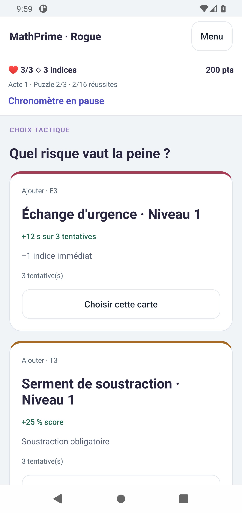

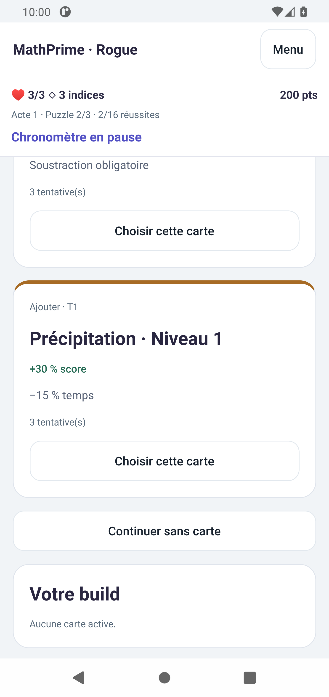

Les trois offres Web se comparent côte à côte et montrent avantage, coût et durée. Sur Android, l’empilement demande de défiler ; la première capture ne suffit pas à comparer trois offres et l’option sans carte. La référence mobile 08 prévoit des cartes bleues plus compactes et un accent corail de sélection. Ses anciennes évolutions et chiffres ne sont pas le catalogue actuel : conserver les 12 cartes, les durées, les améliorations et le refus volontaire, puis adapter la présentation. Les indicateurs de famille ne doivent pas être le seul code de compréhension par couleur.

## 7. Build et contraintes — informations présentes, formes différentes

[Web](assets/R4.3A/web-07-build.jpg) · [Android](assets/R4.3A/android-07-build.png).

Voir les captures de cette étape

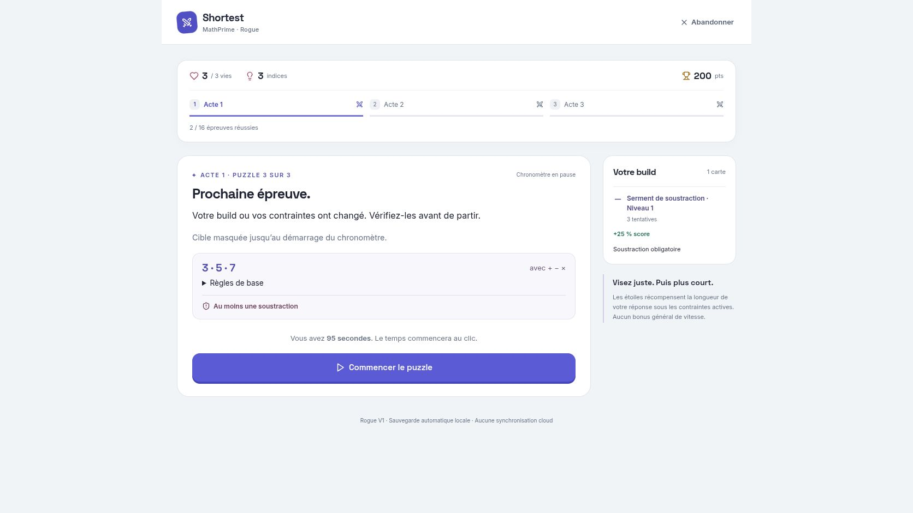

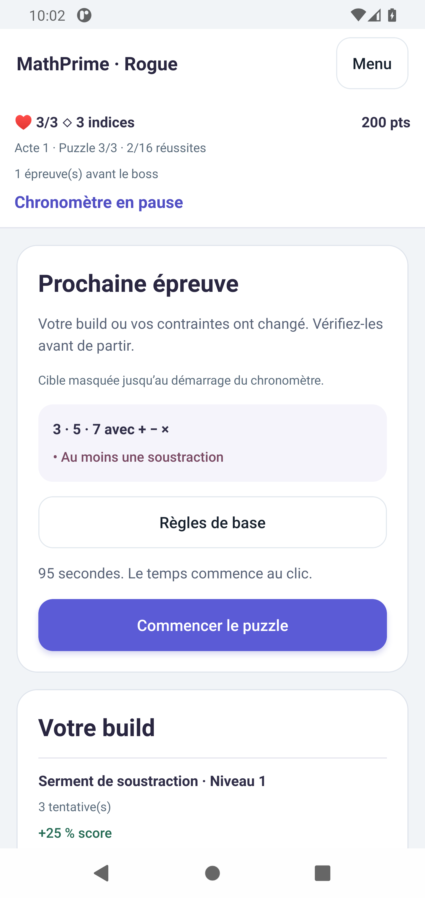

T3 est visible dans le build et son obligation est reprise dans les règles avant démarrage. Le détail Web s’ouvre sans modifier le jeu ; le build Android affiche directement ses informations dans le contenu défilant. Les maquettes 06/07 organisent effets compacts et détail dédié : cette organisation peut être reprise, mais les familles, niveaux, durées restantes et vrais budgets doivent rester exacts. Aucun menu d’effets ne doit suspendre un puzzle actif.

## 8. Diagnostic et échec d’une réponse — précis et compréhensible

[Web](assets/R4.3A/web-08-diagnostic.jpg) · [Android](assets/R4.3A/android-08-diagnostic.png).

Voir les captures de cette étape

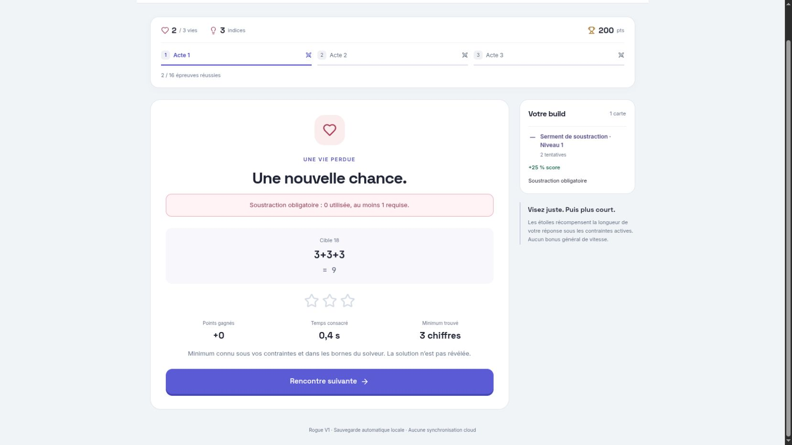

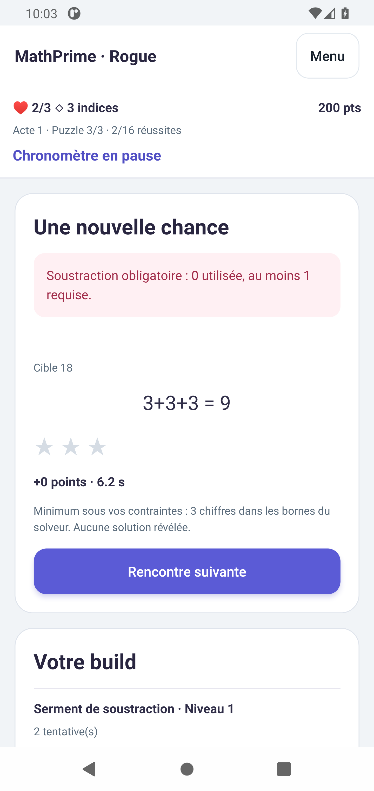

Une réponse volontairement sans soustraction sous T3 affiche « 0 utilisée, au moins 1 requise ». Le texte, la vie perdue et le résultat sont visibles ; le diagnostic ne dépend pas seulement d’une couleur. Une violation de règle validée est bien une réponse définitive et coûte une vie, contrairement à une syntaxe non soumise. Les deux sessions de test passent à deux vies, conformément au comportement actuel. Cette capture est un cas d’erreur provoqué, pas un défaut du moteur. Garder la précision des diagnostics lors du nouvel habillage.

## 9. Boss — identité fonctionnelle claire, mise en scène limitée

[Web](assets/R4.3A/web-09-boss-preparation.jpg) · [Android](assets/R4.3A/android-09-boss-preparation.png).

Voir les captures de cette étape

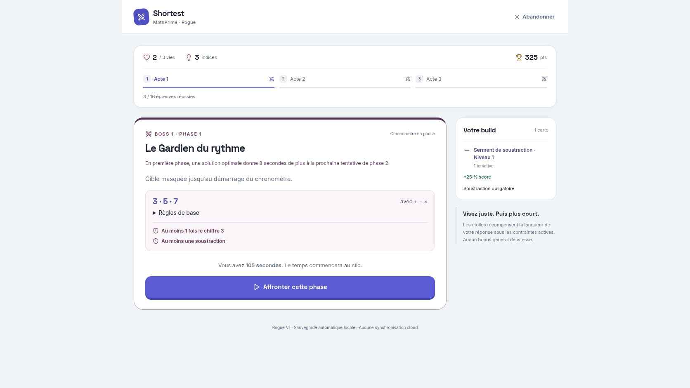

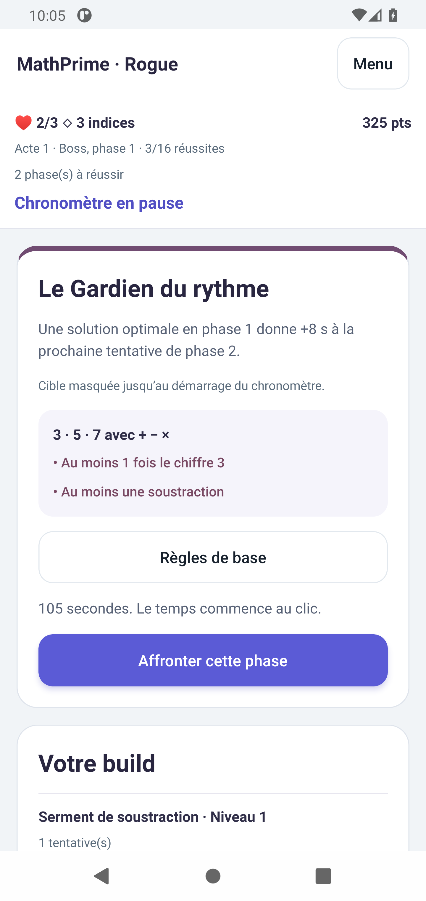

Le nom du Gardien, sa règle de rythme, les phases et les contraintes sont explicités ; la cible reste masquée. Le liseré de couleur distingue le boss, sans encore retrouver le fond bleu nuit et la composition illustrée de la maquette mobile 05. Les anciennes mentions « sans soustraction », « chiffre 1 ajouté » ou « série de 3 cibles » sont des contenus remplacés par le Rogue actuel : ne pas les réimplémenter. Les valeurs et règles actuelles priment, le langage artistique reste la référence.

## 10. Jalon de boss et transition — information conservée, mise en scène à reprendre

[Web](assets/R4.3A/web-10-boss-milestone.jpg) · [Android](assets/R4.3A/android-10-boss-milestone.png).

Voir les captures de cette étape

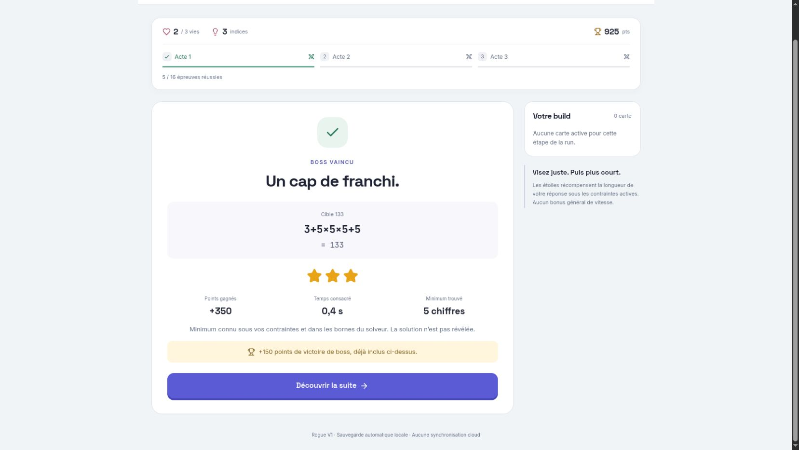

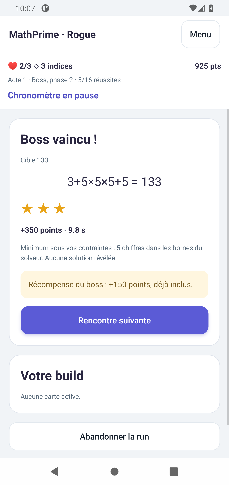

Le premier boss terminé est identifié et sa récompense est annoncée « déjà incluse ». La progression du HUD avance ; l’affichage reste un résultat de puzzle enrichi plutôt que la composition de jalon dédiée de la maquette 09. Reprendre sa hiérarchie et sa projection vers l’acte suivant, en s’appuyant sur les transitions existantes, sans ajouter une nouvelle récompense ni un nouveau démarrage automatique du chronomètre. Le jalon de la référence illustre l’acte 2 ; les captures présentes illustrent le même type d’événement après l’acte 1.

[Entrée acte 2 Web](assets/R4.3A/web-10-act2-transition.jpg) · [Entrée acte 2 Android](assets/R4.3A/android-10-act2-transition.png) : le changement d’acte, la nouvelle carte D2 et son vrai budget sont visibles avant le démarrage. Le Web ajoute une annonce de changement d’acte ; Android l’indique surtout dans son HUD. Prévoir une même hiérarchie narrative sur les deux plateformes avec les données actuelles.

Voir la transition

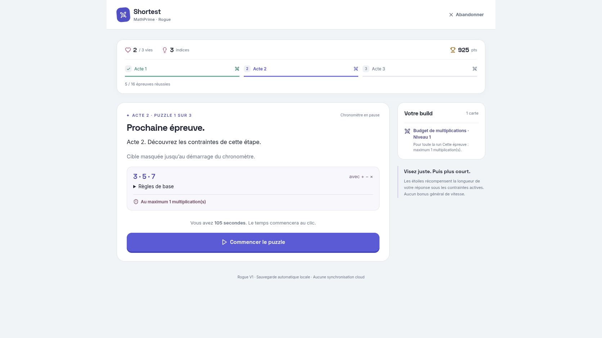

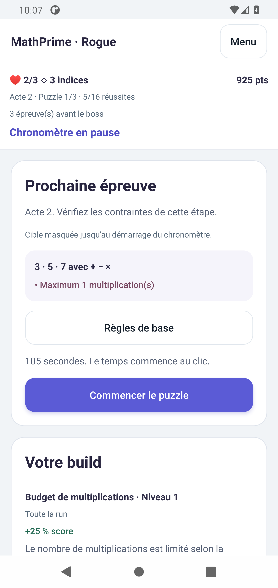

## 11. Amélioration et acte 3 — distinction fonctionnelle à conserver

[Web](assets/R4.3A/web-11-upgrade-offer.jpg) · [Android](assets/R4.3A/android-11-upgrade-offer.png).

Voir les captures de cette étape

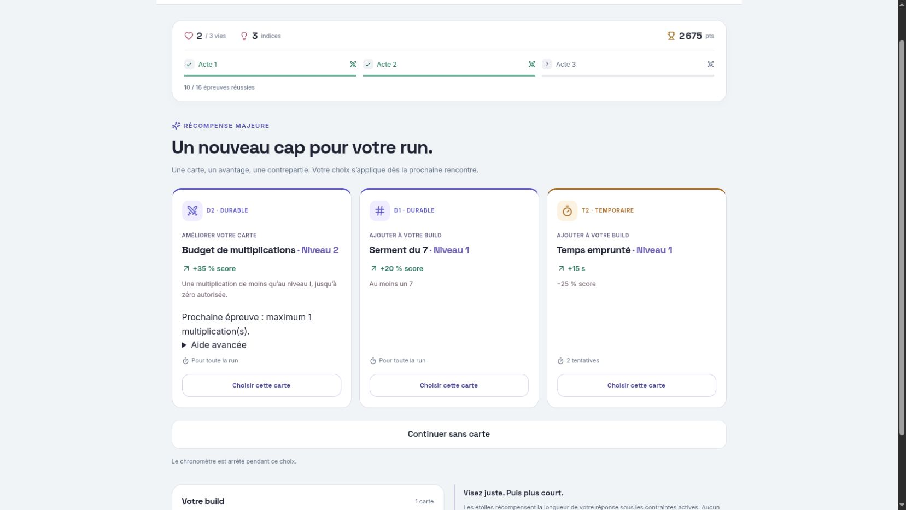

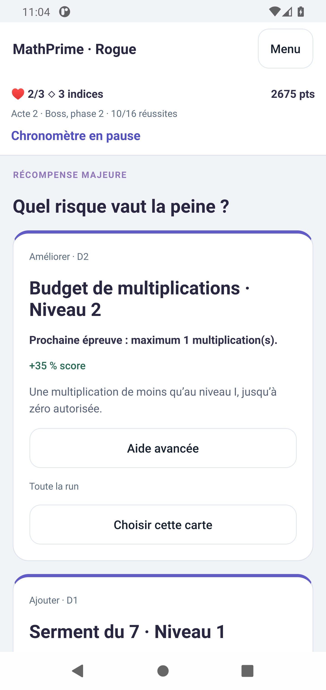

L’offre D2 de niveau II est marquée comme amélioration et distingue son bonus, sa réduction de budget et la limite effective de la prochaine épreuve. Les anciennes maquettes n’ont pas ces niveaux ni cette aide : il faut les adapter, sans remplacer les textes précis par une ancienne description générique. Le Web compare les trois offres ; Android nécessite toujours du défilement. La limite de la prochaine épreuve est un message prioritaire à garder près du coût.

[Acte 3 Web](assets/R4.3A/web-11-act3-transition.jpg) · [Acte 3 Android](assets/R4.3A/android-11-act3-transition.png) : l’amélioration choisie devient D2 II et la prochaine épreuve cumule soustraction et budget. Une première capture Web prise pendant le chargement a été écartée et remplacée par l’écran stabilisé. Préserver la même annonce explicite de contraintes après chaque changement de build.

Voir la transition

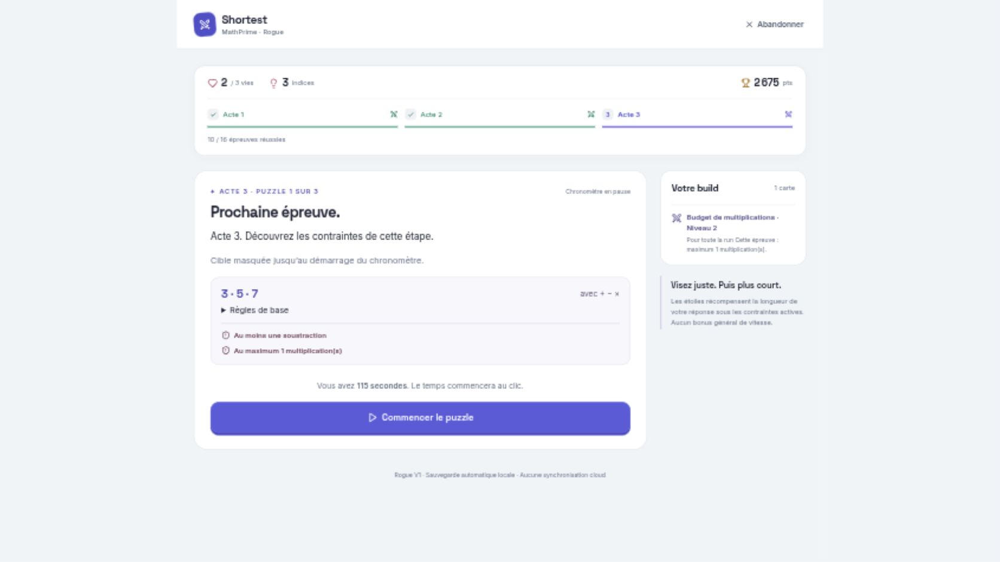

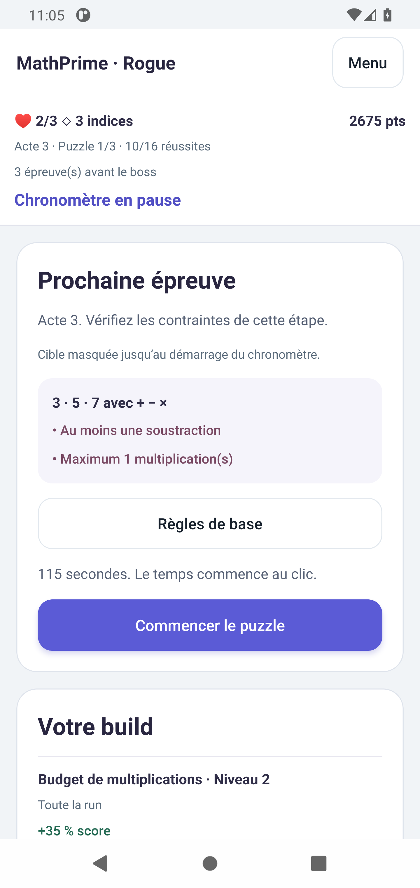

## 12. Victoire officielle — choix corrects, célébration à habiller

[Web](assets/R4.3A/web-12-victory.jpg) · [Android](assets/R4.3A/android-12-victory.png).

Voir les captures de cette étape

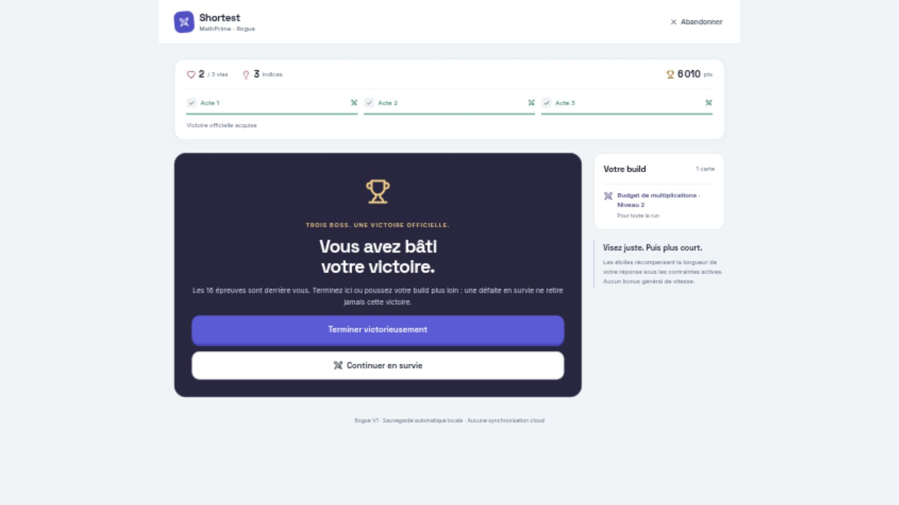

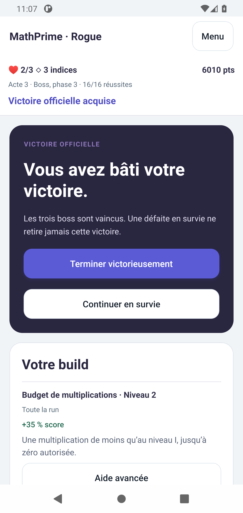

Les trois boss ont été parcourus. L’écran distingue clairement terminer et continuer en survie, avec conservation de la victoire annoncée. Le bloc sombre et la grande typographie constituent un point d’appui pour l’intégration, mais l’accent violet et l’absence de mise en scène illustrée restent éloignés de la référence mobile 10. Ne pas transformer une animation de victoire future en déclencheur de récompense : le moteur a déjà validé la victoire avant cet écran.

## 13. Survie — victoire conservée et cible toujours masquée

[Web](assets/R4.3A/web-13-survival-preparation.jpg) · [Android](assets/R4.3A/android-13-survival-preparation.png).

Voir les captures de cette étape

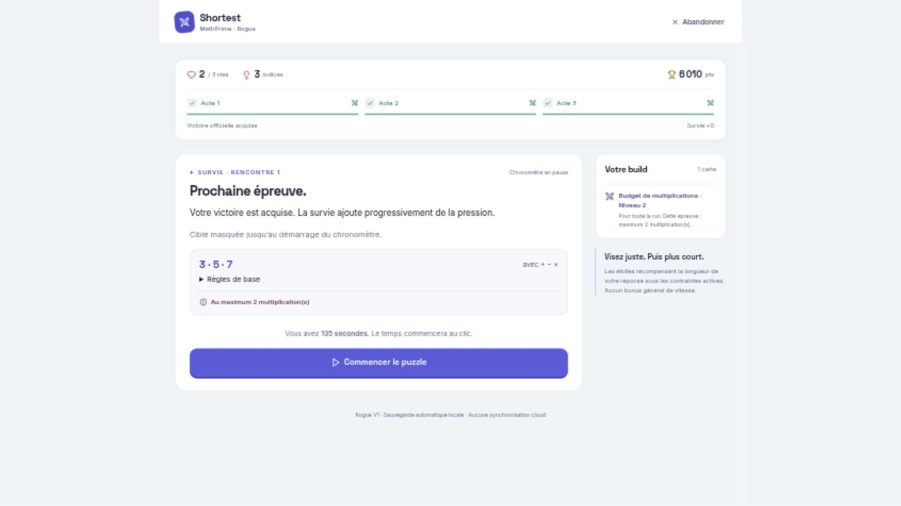

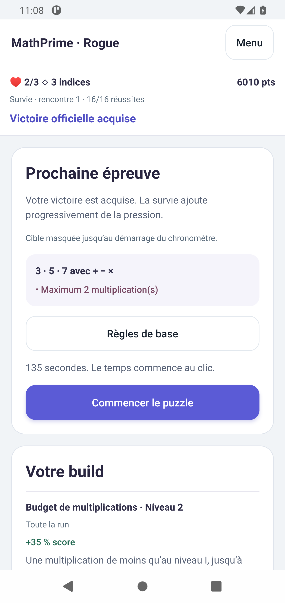

Le score de victoire est de 6 010 sur les deux plateformes. L’entrée en survie rappelle explicitement que la victoire est acquise ; le prochain budget est affiché et la cible reste masquée avant démarrage. Le contenu fonctionnel est adapté à R4.2, sans équivalent précis dans les anciens écrans : reprendre leurs surfaces et leur hiérarchie plutôt que rétablir des valeurs illustratives. La préparation à 135 secondes n’est pas une garantie de difficulté humaine validée.

## 14. Bilan après survie — résultat officiel conservé

[Web](assets/R4.3A/web-14-summary.jpg) · [Android](assets/R4.3A/android-14-summary.png).

Voir les captures de cette étape

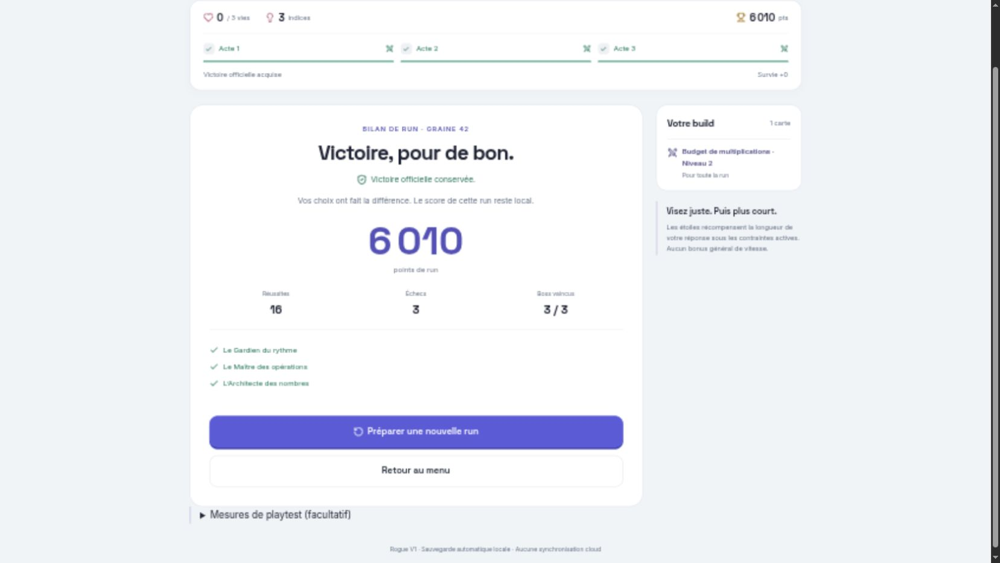

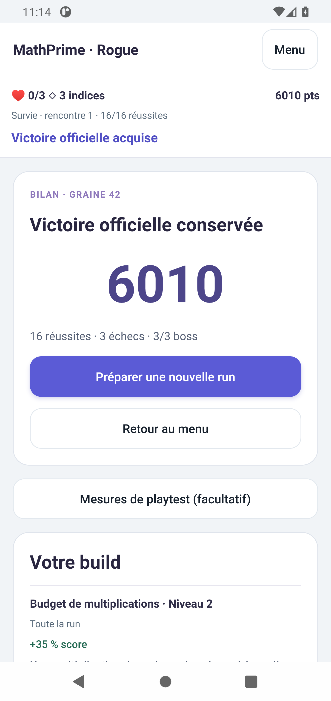

Deux mauvaises réponses volontaires en survie épuisent les vies restantes. Le bilan garde 6 010 points, 16 réussites et les trois boss, avec « Victoire officielle conservée ». Ce comportement observé doit survivre à tout nouvel habillage. Le Web propose mesures facultatives et build latéral ; Android empile le bilan et le build. La référence mobile 14 sert à la hiérarchie, mais les contrats historiques et les nouvelles métriques restent ceux de l’application.

## 15. Défaite avant victoire — message explicite

[Web](assets/R4.3A/web-15-defeat.jpg) · [Android](assets/R4.3A/android-15-defeat.png).

Voir les captures de cette étape

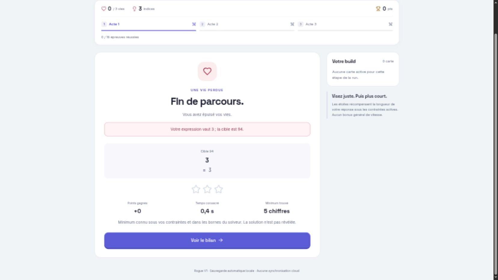

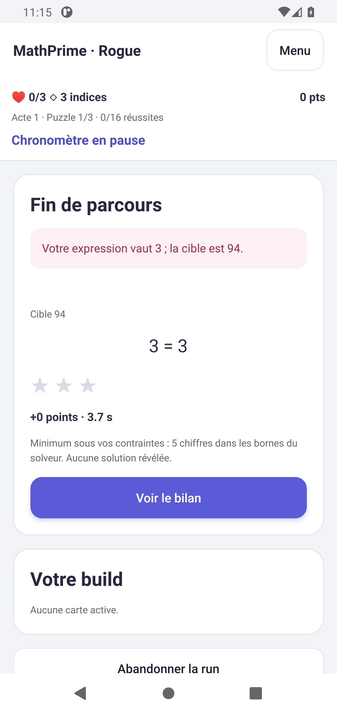

Trois réponses volontairement incorrectes dans une seconde run conduisent à zéro vie, sans victoire officielle. Le diagnostic conserve cible et valeur calculée, puis un bouton unique conduit au bilan. Le ton ne culpabilise pas. L’illustration de la référence mobile 11 reste une intention de composition ; l’animal n’est pas un modèle approuvé. Préserver la différence entre cette défaite et une fin de survie victorieuse.

## 16. Historique — nouvelle surface à adapter

[Web](assets/R4.3A/web-16-history.jpg) · [Android](assets/R4.3A/android-16-history.png).

Voir les captures de cette étape

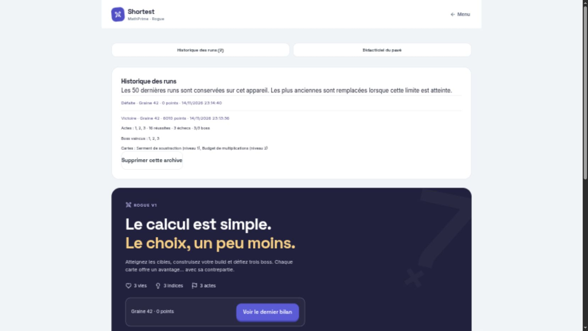

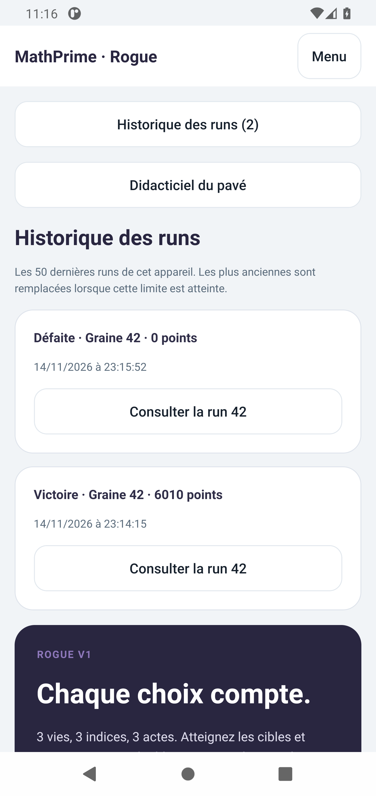

L’historique contient exactement les deux runs de cette campagne : une victoire à 6 010 points et une défaite à zéro. Le détail Web garde actes, réussites, échecs, boss et cartes réellement utilisées, même quand T3 a expiré. La limite de 50 archives est annoncée. Cette surface est nouvelle par rapport aux bundles : reprendre les composants visuels communs, garder les contrats et la confirmation de suppression. La lisibilité des métadonnées fines devra être vérifiée avec les couleurs finales ; aucun test de suppression n’était nécessaire à cet audit.

## 17. Petit écran Web — empilement lisible sur l’historique

[Web 360 × 800](assets/R4.3A/web-17-responsive.jpg).

Voir les captures de cette étape

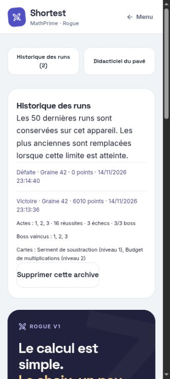

Les deux accès et l’historique se replient en largeur étroite, sans débordement horizontal mesuré sur cette page (contenu 345 px, fenêtre 360 px). Les titres et les dates reviennent à la ligne ; les métadonnées et l’action de suppression restent visibles. Une première capture du fournisseur avait une échelle incorrecte : elle a été rejetée puis remplacée par la capture du viewport. Ce contrôle ne prouve pas l’ergonomie de tous les écrans à cette taille. La taille temporaire du navigateur a été réinitialisée.
