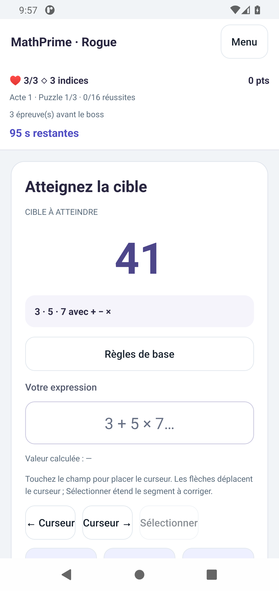
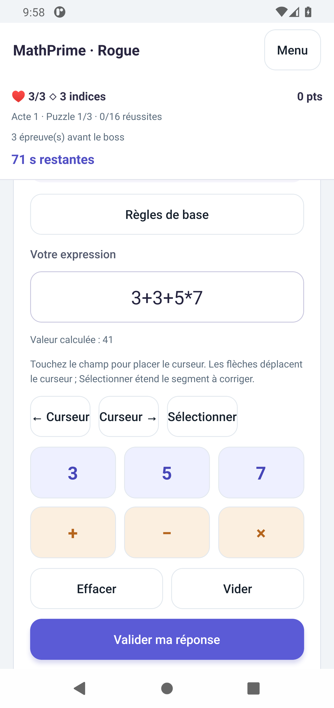
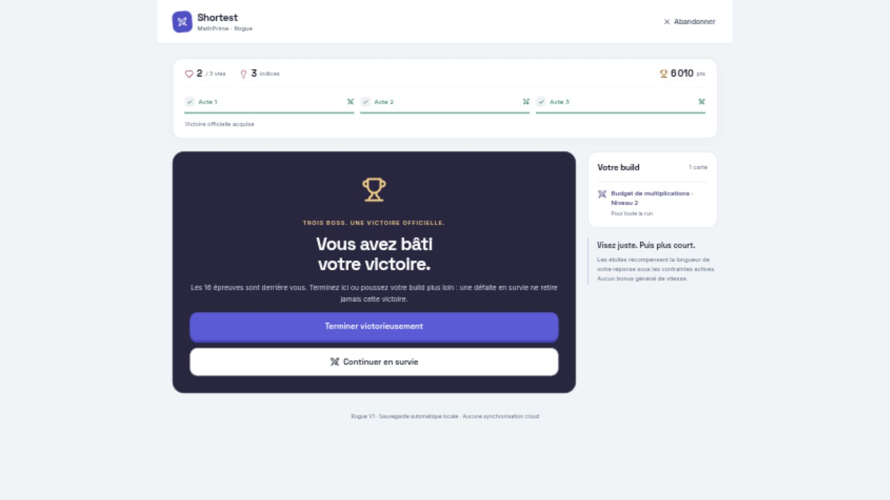

# R4.3A — Direction visuelle retrouvée et audit des interfaces

Audit du 14 novembre 2026. **La direction existante est exploitable ; il faut intégrer ses compositions aux fonctionnalités R4.2, pas recommencer le design. L’identification exacte de la mascotte reste à confirmer depuis les références visuelles.** Aucun changement de production, de règles, de sauvegarde ou d’équilibrage dans ce jalon.

## 1. Base vérifiée et méthode

`modernization` était propre et à jour sur `c6983dacbc36ab5f86d7a82a1150dcfeb4495347`, fusion de la [PR #13](https://github.com/Ayota-Daniel/MathPrime/pull/13). Le commit R4.2 `70b25c783931b746b151f4b414c793c744095125` est bien son ancêtre. Branche d’audit : `feat/rogue-r4-3a-design-audit`.

Lecture du dépôt, des anciens jalons pertinents (M2.2, R3.2.1, R3.2.2, R4.1 et R4.2), des notices et manifestes des deux bundles ; inspection visuelle d’écrans représentatifs, puis parcours réel Web et Android avec captures nouvelles. Les anciens rapports sont conservés et ne valent pas nouvelle preuve de test.

Recherche dans le projet, les pièces jointes, les dossiers de visualisations pertinents et les téléchargements : `MathPrime_etat_du_projet_2026-11-14.md` n’a pas été retrouvé. Il n’a donc pas été utilisé. Les tentatives de lecture du chat d’origine ont dépassé la taille maximale de lecture d’un tour ; aucune validation supplémentaire n’en est déduite.

## 2. Références et provenance

Alias documentaire **`@references`** : dossier local contenant les deux bundles et leurs dossiers dépliés. Sa correspondance réelle reste hors de Git ; la variable locale `MATHPRIME_REFERENCES` permet de la fournir au script. `@attachments` désigne de même les pièces jointes locales. Ces alias ne sont pas des dossiers à créer dans le dépôt.

| Source sous `@references` | Contenu vérifié | Statut et usage |
|---|---|---|
| `MathPrime-interfaces-validees-2026-11-06.zip` et dossier homonyme sans `.zip` | 36 PNG : 26 mobile, 10 Web ; README, manifeste, galerie HTML ; 48 351 292 octets | Les 36 entrées portent la mention archivistique « version validée dans la conversation ». Référence initiale, décisions Classic ensuite révisées. |
| `MathPrime-maquettes-v2-Classic-2026-11-06.zip` et dossier homonyme sans `.zip` | 39 PNG : 27 mobile, 12 Web ; README, CHANGEMENTS-CLASSIC, manifeste, galerie HTML ; 52 717 560 octets | Référence Classic V2 retenue par la demande actuelle ; Rogue inchangé. |

Les 82 fichiers des deux archives correspondent exactement aux fichiers dépliés, et les 75 PNG correspondent aux empreintes des manifestes. **44 images distinctes** : V2 conserve 31 PNG octet pour octet, remplace cinq fichiers et en ajoute trois.

Les huit révisions sont : `mobile/02-classic-niveaux.png`, `mobile/02b-classic-palier-verrouille.png` (ajout), `mobile/20-classement-classic.png`, `web/02-classic-niveaux.png`, `web/02b-classic-palier-verrouille.png` (ajout), `web/05-classic-resultat-deux-etoiles.png`, `web/05b-classic-resultat-une-etoile.png` (ajout), `web/07-classement-classic.png`. Les chemins faisant foi, avec titres, types, plateformes, dates, notes, statut original, dimensions, octets, différences et SHA-256, sont tous dans [l’inventaire complet](R4.3A-assets.json).

**Nuance de validation :** le manifeste V2 du 6 novembre marque encore huit représentations « révision Classic proposée — à valider visuellement », tout en confirmant leurs décisions produit. La demande R4.3A désigne aujourd’hui Classic V2 comme référence validée : cette instruction est retenue pour la suite. On conserve la provenance historique sans inventer une date intermédiaire de validation ni rouvrir les règles produit.

Le brief initial subsiste à `@attachments/41a1d619-0c3f-401e-a175-021aa7e85362/Pasted text.txt`. Ses images de référence originales (jeu violet et schéma Excalidraw) n’ont pas été retrouvées comme fichiers séparés. Les noms originaux `exec-….png` du manifeste sont absents ; leurs copies PNG archivées sont présentes et vérifiées. Aucun autre bundle MathPrime, prototype interactif, modèle de mascotte, source Krita/ORA/Aseprite ou projet musical n’a été retrouvé dans les périmètres examinés. Les autres visualisations sans rapport avec MathPrime ont été exclues.

Les archives de 48/53 Mo restent à leur emplacement d’origine ; elles ne sont ni modifiées ni recopiées dans Git. Les captures de cet audit, beaucoup plus légères, sont versionnées.

## 3. Direction confirmée et écarts des thèmes

Les notices et les images concordent : accueil ivoire, textes aubergine, surfaces de jeu bleu nuit, action principale corail, accents dorés, typographie ronde et hiérarchisée, grands contrôles, motifs `+ − ×` rares en marge et vague basse discrète. Le Rogue Web retenu conserve les grands contrôles et le bleu nuit ; les essais bleu ardoise ou petits contrôles ne sont pas la cible. Une identité commune relie les modes, avec intensité différente pendant la partie.

Références clés dans le dossier V2 : `mobile/01-accueil.png`, `mobile/05-rogue-preparation-boss.png`, `mobile/06-rogue-jeu.png`, `mobile/07-rogue-effets-details.png`, `mobile/08-rogue-evolution.png`, `mobile/09-rogue-jalon-intermediaire.png`, `mobile/10-rogue-victoire-finale.png` et `web/06-rogue-jeu.png`. La composition Web sépare davantage calcul et pavé ; le mobile donne la priorité à la cible et aux contrôles.

| Rôle | Référence retrouvée | Implémentation actuelle | Migration proposée R4.3B |
|---|---|---|---|
| Fond / texte | Ivoire / aubergine | Tokens `bg #F1F4F7`, `ink #16202C`, cartes blanches | Définir des rôles sémantiques communs ; appliquer d’abord au périmètre Rogue. |
| Jeu / panneaux | Bleu nuit, contrastes chauds | Hero sombre `#292640` Android ; nombreux panneaux blancs | Retrouver la surface de jeu nuit et les panneaux bleus, en gardant toutes les contraintes. |
| Action / accents | Corail / or | Token `pri #5B5BD6`, violet Rogue `#514fc4`, or `#E8A317` | Action corail, hiérarchie secondaire explicite ; recalculer contrastes et états. |
| Typographie | Ronde, titres forts, nombres lisibles | Web Space Grotesk / Inter / JetBrains Mono ; natif tailles 11–64 selon rôle | Identifier une police utilisable et licenciée ; établir une échelle commune, sans attribuer aux PNG une police non connue. |
| Décor / identité | Motifs marginaux, vague et emplacement illustré | Icône abstraite, intitulé Web « Shortest », peu de motifs | Uniformiser le nom MathPrime ; garder l’emplacement de mascotte disponible sans choisir d’animal. |

`packages/tokens/index.ts` est la source des valeurs **implémentées**, pas la preuve de validation artistique. Tailwind Web/Native et `apps/mobile/src/theme.ts` le réutilisent, mais le Rogue comporte aussi des couleurs locales dans `apps/web/src/rogue/rogue.css` et `apps/mobile/src/rogue/styles.ts`. Éviter une substitution globale qui changerait Classic, Daily ou les autres écrans pendant R4.3B : ajouter les rôles nécessaires sans changer leurs consommateurs existants, puis migrer Rogue écran par écran.

**Échantillons de pixels, pas tokens approuvés :** dans V2 `mobile/01-accueil.png`, coordonnées natives (20,20) : `#FEF7F0`, (50,130) : `#4A1C32`, (60,1300) : `#F05B4B`. Dans `mobile/06-rogue-jeu.png`, (10,800) : `#0C1A3E`, (100,1650) : `#FA594E`. Ces mesures sRGB illustrent les familles ivoire/aubergine/corail/nuit ; textures, gradients et génération font varier les pixels. Ni hexadécimaux canoniques, ni police, ni grille exacte de composants ne sont livrés par les archives. Formaliser ces spécifications à partir des références avant la première intégration, puis les enregistrer comme **nouvelles décisions d’implémentation**.

## 4. Mascotte : identification exacte à confirmer

Les notices anciennes nomment une piste « panda roux » et les PNG montrent un petit animal roux, museau blanc et queue annelée. Cela décrit leur contenu historique, **pas une mascotte officielle à réutiliser**.

L’utilisateur a indiqué que le panda et le panda roux n’étaient pas le bon animal et qu’il faisait référence à un autre animal présent sur les maquettes. Sa précision sur l’absence de modèle ne constitue pas une décision définitive d’abandonner cette identité. **L’identification exacte reste à confirmer depuis les références visuelles** : les notices retrouvées ne suffisent pas à identifier de manière fiable l’animal visé. Aucun animal n’est inventé, remplacé ou produit pendant ce correctif. « Chibi » reste un terme de style provisoire, sans valeur de nom officiel. Les emplacements, proportions et rôles d’accompagnement illustrés sont conservés ; aucun animal des PNG n’est découpé pour devenir un asset de production avant confirmation.

R4.3B peut avancer sur les composants sans mascotte. R4.4 devra d’abord confirmer l’animal visé à partir des références puis valider son modèle, sa silhouette, ses couleurs et ses expressions, avant de produire les sources correspondantes. Aucune nouvelle illustration n’est produite ici.

## 5. Parcours actuel Web et Android

Captures sur le code R4.2 inchangé : Web construit puis servi sur l’origine isolée `127.0.0.1:5183`, viewport 1672 × 941 ; Android release x86_64, application d’audit `com.shortest.r43aaudit`, AVD Pixel_4_XL, Android 11 / API 30, 1440 × 3040, densité 560 (environ 411 dp de large). Pilotage natif ADB autorisé par l’utilisateur. Aucun remplacement des données de `com.shortest.app` ni de l’origine Web habituelle.

Graine 42 : deux premières réussites, T3, réponse volontaire sans soustraction (une vie perdue), nouvelle tentative réussie, D2 I après le premier boss, choix tactique suivant ignoré, D2 II après le deuxième boss, dernier choix tactique ignoré, puis troisième boss et victoire. Les réponses correctes sont calculées avec le solveur partagé à partir des seules règles visibles puis saisies par les contrôles réels. Aucune injection de sauvegarde ou d’état d’écran. Deux mauvaises réponses en survie conduisent au bilan ; une seconde run est perdue volontairement pour l’autre état final et l’historique.

Le [carnet des captures](R4.3A-capture-notes.md) conserve observations détaillées et images par étape. Toutes sont nouvelles, sauvegardées puis inspectées. Les vues natives défilées sont signalées ; il ne s’agit pas de captures intégrales des écrans.

| Étape | État général observé | Classement et adaptation |
|---|---|---|
| 1. Accueil | Accès clairs, reprise et contexte disponibles | Écart visuel : violet/gris, identité et illustration absentes. |
| 2. Didacticiel | Parcours autonome et explications explicites | Fonction nouvelle ; garder la sélection du curseur et les commandes distinctes. |
| 3. Préparation | Cible masquée, budget annoncé, départ explicite | Fonction conforme ; nouveau contenu à habiller sans afficher la cible trop tôt. |
| 4. Puzzle actif | Saisie réelle opérationnelle | **Ergonomie prioritaire Android : cible et pavé demandent du défilement** ; composition Web trop verticale par rapport à la référence. |
| 5. Résultat correct | Étoiles, score et minimum borné compréhensibles | Structure réutilisable, surfaces et hiérarchie à rapprocher des maquettes. |
| 6. Cartes | Coût, durée et avantage visibles | Android : comparaison longue ; adapter la compacité, garder « sans carte ». |
| 7. Build | T3 et obligations exactes, détails accessibles | Nouvelle richesse à préserver : familles, niveaux, durées, limites effectives. |
| 8. Diagnostic | Obligation manquante expliquée en texte | Conforme fonctionnellement ; style d’erreur à harmoniser. L’échec provoqué n’est pas un bug. |
| 9. Boss | Nom et phases explicites, cible masquée | Mise en scène trop discrète ; conserver les trois boss actuels. |
| 10. Jalon / acte 2 | Récompense déjà incluse et progression claires | Célébration et narration à rapprocher du jalon illustré ; ne pas recréditer la récompense. |
| 11. Amélioration / acte 3 | D2 II distingué, prochain budget annoncé | Fonction nouvelle, adaptation nécessaire des anciennes cartes. |
| 12. Victoire officielle | Deux choix positifs, victoire clairement acquise | Bonne structure ; palette et célébration à intégrer. |
| 13. Survie | Victoire conservée, nouvelle préparation masquée | Fonction actuelle prioritaire sur les anciens exemples chiffrés. |
| 14. Bilan après survie | 6 010 points et 3/3 boss conservés | Conforme ; reprise de la hiérarchie visuelle sans changer le contrat. |
| 15. Défaite avant victoire | Diagnostic puis bilan explicites | Conforme ; garder sa distinction avec une fin de survie victorieuse. |
| 16. Historique | Deux archives distinctes : victoire et défaite | Surface nouvelle ; adapter l’identité en gardant les données historiques. |
| 17. Historique Web étroit | Retours à la ligne lisibles à 360 × 800 | Aucun débordement horizontal mesuré sur cette page ; contrôle limité à cette surface. |







Les maquettes comportent d’anciens contenus : ajout du chiffre 1, interdiction de soustraction, cartes anciennes, nombre illustratif de cibles par boss. **Ne pas réintroduire ces règles.** Les chiffres restent 3/5/7, les phases et cartes restent celles de R4.2. Un chrono illustré à 38 secondes restantes n’est pas une allocation initiale inférieure à 60 secondes. Les notices identifient aussi une division accidentelle sur une image et des étoiles symboliques de l’ancien accueil : aucune valeur de spécification moteur.

### Écarts prioritaires et accessibilité

1. **P1 — garder cible, expression et pavé utilisables ensemble sur Android.** Réduire les hauteurs de structure et déplacer les détails secondaires dans des panneaux adaptés. Conserver le chrono visible, la sélection et le clavier applicatif ; ne pas supprimer les commandes de curseur pour gagner de la place. Preuve : étape 4.
2. **P1 — formaliser puis appliquer le système visuel retrouvé.** Le violet/gris actuel est cohérent entre beaucoup de composants mais ne reproduit pas la direction ivoire/aubergine/nuit/corail. Preuves : étapes 1, 3–6, 9–12. Aucune nécessité de redesign artistique.
3. **P2 — comparer les cartes sur mobile.** Réduire l’empilement, préserver avantage/coût/durée, niveaux et budget effectif ; tester aussi les libellés longs et l’option de refus. Preuves : étapes 6 et 11.
4. **P2 — rendre les phases et règles essentielles immédiatement lisibles.** Garder « sans parenthèses / multiplication prioritaire » à proximité du jeu, comme prévu par les notices, sans cacher les contraintes ; harmoniser les annonces d’actes et boss. Preuves : étapes 3, 7, 9–11.
5. **P2 — valider contrastes et interaction accessible.** Le petit kicker natif `#8e78bb` sur `#f1f4f7` donne environ **3,43:1**, sous 4,5:1 pour un texte normal ; le recalcul porte sur les styles réels, pas la compression JPEG. Le timer violet sur blanc atteint environ 6,43:1 et le texte d’erreur sur son fond 6,40:1. Ces exemples ne constituent pas une certification globale. Le viewport Web impose `maximum-scale=1.0` : risque de zoom à tester. Ajouter focus, labels, état sélectionné et signal non uniquement coloré aux contrôles futurs.

Références de validation : [WCAG contraste minimum](https://www.w3.org/WAI/WCAG22/Understanding/contrast-minimum) et [taille minimale des cibles](https://www.w3.org/WAI/WCAG22/Understanding/target-size-minimum) (24 × 24 CSS px avec exceptions d’espacement ; viser des commandes tactiles confortables ne remplace pas cette vérification). TalkBack, zoom réel, grandes polices système, clavier externe et daltonisme n’ont pas été validés dans cette campagne.

## 6. Classic V2 à préserver pour son futur jalon

Les images `mobile/02-classic-niveaux.png`, `mobile/02b-classic-palier-verrouille.png` et `web/05b-classic-resultat-une-etoile.png`, effectivement inspectées, confirment les décisions consignées dans les notices V2 : sélection réelle des niveaux, progression, filtre des niveaux à améliorer, meilleurs résultats rejouables, total d’étoiles et paliers cumulés. Toute solution correcte à une, deux ou trois étoiles termine le niveau et ouvre le suivant, sauf palier collectif ; trois étoiles restent un objectif de maîtrise facultatif. Les étoiles totales sont la somme des meilleurs scores par niveau, pas une monnaie répétable par rejeu.

L’exemple 47/50 étoiles au niveau 20, 19 niveaux terminés et trois étoiles manquantes est explicitement **non équilibré**. Les paliers autour de 40/60 ne sont pas des seuils définitifs. Le classement provisoire trie étoiles totales puis niveaux terminés ; aucun troisième départage n’est ajouté. Les performances Rogue distinguent score d’une run et progression maximale.

Le dépôt actuel conserve encore `canAdvance` conditionné à trois étoiles en Classic (`packages/engine/src/store.ts`) et les accueils conduisent directement au jeu. C’est une dette d’intégration identifiée, pas une raison de réécrire Classic pendant R4.3A/B. La règle V2 reste la référence future ; le README distingue désormais décision et état implémenté.

## 7. Animation : inventaire et feuille de production

Aucun modèle, `.kra`, `.ora`, `.aseprite`, spritesheet ou clip d’animation de mascotte retrouvé. Les PNG sont des compositions aplaties, sans poses séparées ni garantie de cohérence d’un animal à l’autre. `branding/` contient des concepts SVG abstraits, wordmark et icône, pas un modèle animal. Krita est installé, sans production réalisée ici.

**Proposition de production à valider en R4.4**, commune Web/Android ; toutes les lignes ci-dessous sont manquantes. Les durées et nombres d’images ne sont pas d’anciennes décisions approuvées.

| Asset proposé | Fonction / déclencheur existant | Rythme et boucle proposés | Sprites de départ | Réduction des animations |
|---|---|---|---|---|
| `mascot-idle` | Accompagner l’accueil ou une préparation stable | 2–4 s, boucle calme | 8–12 poses | Pose fixe |
| `mascot-thinking` | Puzzle démarré, réponse en cours | 1,5–3 s, boucle discrète | 8–12 | Pose attentive fixe |
| `mascot-success` | Résultat correct validé | 0,6–1 s, une fois | 8–12 | Pose positive fixe |
| `mascot-three-stars` | Résultat à trois étoiles | 1–1,5 s, une fois | 12–18 | Pose et étoiles statiques |
| `mascot-failure` | Réponse définitive échouée / temps épuisé | 0,6–1 s, une fois, ton bienveillant | 8–12 | Pose fixe sans secousse |
| `mascot-time-critical` | Franchissement du seuil de temps existant | 0,8–1,2 s, boucle modérée | 8–12 | Icône + texte fixes, aucun clignotement |
| `mascot-last-life` | Une vie restante | 1,5–3 s, boucle calme | 8–12 | Pose fixe |
| `mascot-record` | Nouveau record confirmé une seule fois | 1–1,8 s, une fois | 12–20 | Badge fixe |
| `mascot-boss` | Entrée de rencontre boss, avant départ | 1–2 s, une fois | 12–20 | Pose de rencontre fixe |

Sources proposées : `art/mascot/<etat>.kra`, exports séparés `mascot-<etat>-v1.png` puis WebP si le décodage Android est confirmé, métadonnées JSON (taille de cellule, nombre de frames, fps, boucle, point d’ancrage, dimensions logiques). Aucune espèce dans les noms de fichiers. Feuilles à alpha, marges régulières et dimensions réduites au besoin réel ; vérifier budgets mémoire après décodage, pas seulement taille compressée. La [documentation Krita](https://docs.krita.org/en/reference_manual/render_animation.html) prévoit les séquences d’images ; garder les sources et les PNG avant les formats de diffusion.

Web : CSS pour les transitions simples et l’avancement de frames ; Motion seulement si un besoin réel le justifie, pas de dépendance ajoutée dans cet audit. Android : Reanimated 4.7.1 est installé mais pas utilisé actuellement par les composants Rogue ; l’utiliser pour présentation et frames lorsque pertinent, jamais pour piloter le moteur. Le réglage de réduction des animations doit arrêter la boucle de frames et afficher une pose, avec le même message textuel. Priorité d’états proposée : résultat / boss ponctuel, puis temps critique, dernière vie, réflexion, repos ; éviter plusieurs animations concurrentes. Au retour d’arrière-plan, se recaler sur l’état réel, sans rejouer les récompenses. Aucun sprite ne doit être nécessaire pour connaître les vies, le temps ou un diagnostic.

## 8. Audio : fonctionnel, provisoire et restant à produire

`tools/gen-music.cjs` synthétise une boucle Am–F–C–G de 12 secondes (accords de trois secondes, pad et arpège). Les quatre fichiers `apps/web/public/music.wav`, `apps/web/public/music-rogue.wav`, `apps/mobile/assets/music.wav` et `apps/mobile/assets/music-rogue.wav` sont **strictement identiques** (SHA-256 complet dans l’inventaire ; préfixe `2c8e8f0b7d07bf2b0b`). PCM mono, 44,1 kHz, 16 bits. Les noms main/Rogue ne prouvent donc pas deux compositions. `npm run music` régénère les fichiers principaux ; ne pas l’utiliser comme fabrication d’une bande-son finale.

Les six WAV natifs produits par `apps/mobile/scripts/gen-sfx.cjs` sont présents : `select` 70 ms, `success` 280 ms, `fail` 200 ms, `tick` 35 ms, `timeup` 540 ms, `record` 500 ms. Le Web synthétise ces six familles d’événements avec Web Audio ; ses enveloppes ne sont pas identiques aux fichiers natifs. `apps/web/src/lib/audio.ts` utilise aussi HTMLAudio et `apps/mobile/src/audio.ts` utilise Expo Audio : deux pistes logiques main/Rogue, réglages son/musique et volume musical 0,25. Les erreurs de chargement sont absorbées ; un futur diagnostic de développement pourra aider sans bruit pour le joueur.

**Câblage et formats présents vérifiés ; pas d’écoute critique ni de validation acoustique.** L’émulateur a été lancé sans audio. Ces sons synthétiques sont des placeholders fonctionnels, pas des compositions originales approuvées. Aucun projet LMMS, MIDI, master ou composition finale distincte retrouvé. LMMS est installé ; aucune composition n’a été produite pendant l’audit.

Feuille de production proposée :

| Famille / noms futurs | Intention | Sources et livraisons |
|---|---|---|
| `music-menu-v1` | Accueil chaleureux, faible fatigue | Projet LMMS, WAV master, boucle avec points documentés |
| `music-classic-v1` | Concentration stable | Même identité harmonique, composition distincte |
| `music-daily-v1` | Rendez-vous reconnaissable | Boucle dédiée et transition courte |
| `rogue-base-v1`, `rogue-act2-layer-v1`, `rogue-act3-layer-v1` | Intensité croissante selon l’acte | Stems de même tempo, longueur et départ ; boucle sans coupure |
| `rogue-boss-layer-v1` | Présence du boss | Couche compatible ou section synchronisée, entrée non bloquante |
| `rogue-tension-layer-v1` | Temps critique / dernière vie | Une couche plafonnée, règles de priorité et hystérésis |
| `stinger-victory-v1`, `stinger-defeat-v1`, `stinger-record-v1` | Résultat ponctuel, sans doublon | Courts WAV, queue sonore et ducking documentés |
| `sfx-select`, `sfx-success`, `sfx-fail`, `sfx-tick`, `sfx-timeup`, `sfx-record` | Remplacement artistique cohérent des six événements | WAV courts, gain/crête et licence documentés, correspondance Web/native |

Conserver `.mmp`/`.mmpz`, instruments/presets et licences, WAV non destructif ; conserver MIDI lorsque le compositeur en dispose, sans promettre que LMMS exporte nativement chaque projet en MIDI. La [documentation d’export LMMS](https://docs.lmms.io/user-manual/production/exporting) précise les sorties audio. Avant livraison, choisir format de diffusion selon les capacités réellement testées des deux lecteurs ; garder les masters séparés des assets embarqués.

R4.5 : mixage adaptatif à partir d’événements existants, transitions en fondu, hystérésis de tension, reprise du contexte audio Web après geste utilisateur, focus audio Android, passage en arrière-plan, réglages persistants, plafonnement des voix et arrêt propre. Horloge audio et horloge de jeu restent indépendantes. Ni chargement musical, ni animation, ni fin de stinger ne déclenchent points, récompense, vie ou sauvegarde. Prévoir écoute sur haut-parleur, casque et appareil physique avant validation finale.

## 9. Plan d’exécution sans nouvelle direction

### R4.3B — Intégration visuelle Rogue

1. Enregistrer les rôles de couleurs, typographie et espacements dérivés des références, avec contrastes mesurés et statut « choix d’implémentation ». Préparer une table de correspondance référence → composant → plateforme. L’identification exacte de la mascotte reste à confirmer ; préserver son emplacement sans inventer de visuel de remplacement.
2. Introduire les rôles de thème sans changer les modes existants (`packages/tokens`, thème natif, Tailwind et styles Rogue). Préférer des styles lisibles à une nouvelle bibliothèque de composants.
3. Intégrer un écran pilote préparation/actif Web + Android : nuit, cible, expression, chiffres ivoire, opérateurs bleus, action corail. Réserver le petit rappel des règles ; résoudre d’abord la visibilité cible/pavé. Contrôler 360 px Web, petit Android, tailles de police et Safe Areas avant de généraliser.
4. Migrer accueil/didacticiel, résultats/diagnostics, cartes/améliorations/build, annonces d’actes/boss, victoire/défaite/survie/bilan, historique/export. Composants concernés : `apps/web/src/components/rogue/*`, `apps/web/src/screens/Rogue.tsx`, `apps/mobile/src/rogue/*`, `apps/mobile/src/screens/Rogue.tsx`. Les nouvelles surfaces reprennent le vocabulaire existant sans supprimer leurs informations.
5. Vérifier saisie et focus après chaque changement de structure. Garder les précautions Fabric : `removeClippedSubviews={false}`, conteneurs requis non repliés, restauration du focus/sélection, absence de clavier système sur le pavé, scroll initial et traitement Android du clavier. Pas de refonte de l’adaptateur de saisie.
6. Lancer tests, trois typechecks, build Web et Android réel ; comparer les captures avec les références. Une modification visuelle ne doit pas changer les simulations déterministes ni le contenu des sauvegardes. Ne pas remplacer les archives ou leur schéma pour les afficher.

Critères de sortie : chaque surface du tableau dispose de la nouvelle identité et de ses états longs/vides/erreur ; pavé utilisable sans perdre la cible sur les tailles retenues ; coûts de carte, minimum borné et victoire conservée toujours explicites ; aucune régression de timer, curseur, navigation ou restauration. Aucun besoin de produire une mascotte ou une bande-son pour franchir ce jalon.

### R4.3C — Validation visuelle

Rejouer le même parcours et les états supplémentaires de R4.2, capturer aux dimensions des références puis aux tailles réelles, comparer composition, hiérarchie, couleur et espacement. Accepter les différences de contenu métier documentées. Tester tactile, clavier/focus, zoom, grandes polices, TalkBack, réduction des animations et Safe Areas sur les deux plateformes ; corriger les défauts observés. Les PNG générés ne sont pas une spécification au pixel de chaque caractère.

### R4.4 — Production artistique

Confirmer l’identification depuis les références et valider le modèle de mascotte, puis produire les neuf états avec sources, spritesheets et métadonnées. Composer et valider les musiques originales, couches Rogue et SFX avec sources et droits. Revue artistique et écoute avant diffusion ; budgets de poids/mémoire fixés sur appareil. Cette production reste un jalon explicite, sans recycler la boucle synthétique comme résultat final.

### R4.5 — Intégration et polish

Brancher animations et audio aux événements existants, transitions, réglages et cycle de vie. Mesurer mémoire/frames/temps de démarrage sur Android et Web, tester absence de doublons et fallback statique/silencieux. Valider sur appareil physique et finaliser l’accessibilité. Les effets ne doivent retarder ni la saisie ni les calculs.

## 10. Décisions, dépendances et contrôles

Le [registre de décisions](PROJECT_DECISIONS.md) sépare décisions actuelles, traces archivées et propositions futures. Questions restantes : valeurs canoniques et police à arrêter pour R4.3B ; identification de la mascotte à confirmer et modèle/sources/licences à valider pour R4.4 ; paramètres artistiques et techniques du mixage à valider pour R4.5. **Aucune ne bloque la remise de cet audit.** L’absence de modèle de production ne signifie pas l’abandon de l’identité visée : cette identification reste à confirmer avant toute nouvelle illustration.

Invariants : mathématiques 3/5/7 et +/−/×, équilibrage R4.2, 12 cartes et trois boss, allocations d’au moins 60 secondes, cible masquée jusqu’au démarrage, diagnostics et indices actuels, contrats/sauvegardes/historique, saisie Android et protections Fabric. Aucun changement à Classic, Daily, autres modes, Supabase ou classement compétitif. Les anciennes docs et archives restent intactes.

Contrôles réellement effectués :

- Build de production Web réussi, puis parcours réel et captures sur cette sortie.
- Build Android release x86_64 réussi avec identifiant d’application d’audit appliqué temporairement par un script Gradle externe au dépôt ; installation et parcours natif ADB sur l’AVD existant, sans export Hermes présenté comme test natif.
- Victoire complète à 6 010 points sur les deux plateformes ; fin de survie conservant la victoire, défaite préalable et deux archives distinctes. Aucun test de campagne statistique de difficulté humaine ici.
- Vérification des archives et SHA-256, inventaire rejoué et comparé pour déterminisme, syntaxe Python, liens locaux des livrables et `git diff --check` ; résultats finaux consignés dans la livraison.

Limites : un AVD Android 11, aucun appareil physique, pas de campagne complète des interruptions/persistance ni de suppression d’archives refaite dans cet audit visuel. Le clavier et la saisie observés ne constituent pas un test de toutes les langues et méthodes d’entrée. Pas d’écoute audio, pas de validation TalkBack ou de performance animée. Les JPEG Web sont ceux du fournisseur de capture, sans retouche ; la vue étroite a été recapturée quand le premier rendu avait une échelle incorrecte. Les rares prises pendant un chargement ont été rejetées et remplacées.

Reproduction de l’inventaire (Python 3.11+ ; lecture seule des sources) :

```bash
# Définir MATHPRIME_REFERENCES localement vers les bundles retrouvés.
: "${MATHPRIME_REFERENCES:?Définir le dossier local des références}"
python3 tools/audit-visual-assets.py \
  --references "$MATHPRIME_REFERENCES" \
  --project . --revision c6983dacbc36ab5f86d7a82a1150dcfeb4495347 \
  --out docs/R4.3A-assets.json
```

### Résultat final des vérifications locales

- `npm test` : **150/150** réussis (129 moteur, 15 Web, 6 mobile).
- `npm run typecheck` puis `npm run typecheck -w @shortest/mobile` : réussis ; incluent les projets TypeScript de tests, benchmark, playtest et Supabase déclarés par ces scripts.
- `npm run build -w @shortest/web` : réussi avant les captures (2,58 s).
- `:app:assembleRelease -PreactNativeArchitectures=x86_64` avec l’identifiant isolé : réussi (1 min 4 s), puis application réellement installée et jouée. Avertissement Gradle de dépréciations pour Gradle 10 conservé, sans modification de configuration.
- Inventaire : **36 + 39 références**, **82 fichiers d’archives vérifiés**, **39 captures nouvelles**, zéro erreur de correspondance ; seconde génération strictement identique.
- Compilation syntaxique du script Python et contrôle des liens locaux des livrables : réussis. `git diff --check` réussi ; vérification répétée sur les fichiers ajoutés avant commit.

Aucune nouvelle simulation d’équilibrage n’est exécutée : le moteur et ses paramètres ne changent pas dans cet audit.

Le build Android a également été relancé sans le script d’identifiant isolé : réussite en 44 s, artefact standard `com.shortest.app` restauré sans installation sur les données habituelles. L’application d’audit a ensuite été désinstallée ; ses seules données étaient celles des deux runs de cette campagne. Le script refuse également une racine de références absente avec un code de sortie non nul, vérifié sur un chemin de test inexistant.

Correctif du 15 novembre 2026 : les chemins de provenance utilisent désormais des alias documentaires. Les mesures, références, empreintes et captures de l’audit restent inchangées ; voir [le bilan de confidentialité](R4.3A-privacy-cleanup.md).
